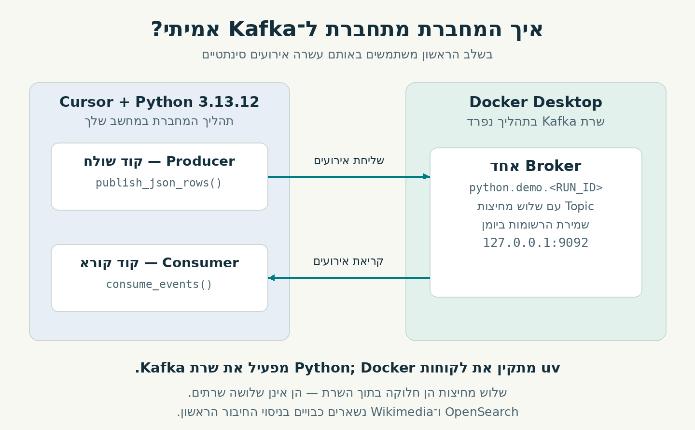

<div dir="rtl" lang="he">

# Kafka עם Python — מעבדה לסטודנטים

מחברת לימוד בעברית עם **17 שלבים, 36 תאי קוד, תרגילים ופתרונות וארבעה תרשימים**. סביבת העבודה היא **Cursor + uv + Python 3.13.12**. המסלול המומלץ כאן מחבר את המחברת לשרת Kafka מקומי ב־Docker.

**מתחילים מכאן:** פתחו את [START_HERE_HE.html](START_HERE_HE.html) בדפדפן מתוך תיקיית הפרויקט במחשב, או עקבו אחר השלבים הבאים. GitHub עשוי להציג את קוד ה־HTML; כדי לקרוא את המדריך המעוצב יש לפתוח את הקובץ המקומי.

**להבנת השיעור:** קראו את [המדריך המפורט למחברת](docs/NOTEBOOK_WALKTHROUGH_HE.md), הכולל תרשים זרימה, הסבר לכל 17 השלבים, דוגמאות קוד ופירוש התוצאות.

## מה צריך להתקין?

| רכיב | למה הוא משמש? |
|---|---|
| [Git](https://git-scm.com/downloads) | העתקת הפרויקט מ־GitHub למחשב |
| [Cursor](https://cursor.com/downloads) | פתיחת הפרויקט והרצת המחברת |
| הרחבות Python ו־Jupyter ב־Cursor | עריכת Python ובחירת Kernel למחברת; מזהי ההרחבות הם `ms-python.python` ו־`ms-toolsai.jupyter` |
| [uv](https://docs.astral.sh/uv/getting-started/installation/) | התקנת גרסת Python המתאימה וניהול החבילות |
| [Docker Desktop ל־Windows](https://docs.docker.com/desktop/setup/install/windows-install/) | הפעלת שרת Kafka במכולת Linux |

ב־Windows, Docker Desktop צריך לפעול במצב **Linux containers**, עם סביבת WSL 2 תקינה לפי מדריך ההתקנה הרשמי. את Python 3.13.12 נתקין בעזרת uv בשלב 2. **אין צורך בחשבון Confluent או בשירות ענן** למעבדה המקומית.

מדריך התקנה מפורט ופתרון תקלות נמצאים בקובץ [Kafka_Installation_Guide_HE.html](Kafka_Installation_Guide_HE.html), שאותו פותחים מקומית בדפדפן.

## 1. מעתיקים את הפרויקט ופותחים אותו ב־Cursor

פתחו מסוף PowerShell והפעילו:

</div>

```powershell
git clone https://github.com/paulavrahami/kafka-python-lesson.git
cd kafka-python-lesson
```

<div dir="rtl" lang="he">

ב־Cursor בחרו **File → Open Folder** ופתחו את תיקיית `kafka-python-lesson`. זו התיקייה שבה נמצאים `pyproject.toml` וקובץ המחברת. פתחו בה את המסוף המשולב: **Terminal → New Terminal**.

**את כל פקודות PowerShell במדריך מריצים במסוף, מתוך תיקיית הפרויקט. אין להדביק אותן בתא Python במחברת.**

## 2. מכינים את סביבת Python

</div>

```powershell
uv python install 3.13.12
uv sync --locked
```

<div dir="rtl" lang="he">

הפקודות יוצרות את סביבת `.venv` ומתקינות את החבילות בהתאם ל־`uv.lock`, כולל `ipykernel` ולקוח Kafka לפייתון. `.venv` נוצרת במחשב שלכם ואינה נשמרת במאגר. ההתקנה הראשונה דורשת אינטרנט. אין צורך להתקין חבילות באמצעות `pip` מתוך המחברת.

אם כבר פתחתם את המחברת בסביבה קיימת, עצרו את ה־Kernel לפני סנכרון הסביבה, במיוחד ב־Windows.

## 3. מפעילים Docker ואת שרת Kafka

פתחו **Docker Desktop** מתפריט Start והמתינו עד שמנוע Docker פועל. לאחר מכן הפעילו במסוף של Cursor:

</div>

```powershell
uv run --locked python scripts/kafka_docker.py start
```

<div dir="rtl" lang="he">

הסקריפט בודק את Docker, מוריד את התמונה `apache/kafka:4.4.0` אם היא חסרה, ויוצר מכולה בשם `kafka-python-lab`. ההורדה הראשונה עשויה להימשך כמה דקות. לאחר מכן הוא ממתין לתשובה מ־Kafka.

אם כבר קיימת מכולה בשם זה עם התמונה ומיפוי הפורטים המתאימים, הסקריפט משתמש בה. אם היא עצורה, הוא מפעיל אותה. במקרה של התנגשות בשם או בהגדרות תתקבל הודעה; הסקריפט אינו מוחק מכולות או נתונים כדי לפתור את ההתנגשות.

בסיום תקין יופיע:

</div>

```text
Kafka is ready inside the container.
Host bootstrap address: 127.0.0.1:9092
Next: uv run --locked python scripts/check_kafka.py
```

<div dir="rtl" lang="he">

כתובת החיבור של המחברת היא `127.0.0.1:9092`. הספרייה `confluent-kafka` פועלת בתוך סביבת Python כלקוח; **שרת Kafka עצמו פועל בנפרד ב־Docker**.

## 4. בודקים שהמחשב מצליח להתחבר ל־Kafka

</div>

```powershell
uv run --locked python scripts/check_kafka.py
```

<div dir="rtl" lang="he">

בדיקה זו מבקשת מידע מ־Kafka דרך כתובת החיבור, ואחר כך בודקת גם את כתובת השרת שמוחזרת במידע. כך נבדק חיבור בפרוטוקול Kafka, מעבר לפתיחת פורט בלבד. הבדיקה אינה יוצרת Topics ואינה שולחת הודעות.

המעבדה מפרסמת את פורט Docker על `127.0.0.1`, ולכן המחברת וסקריפט הבדיקה משתמשים ב־IPv4 באופן עקבי (`broker.address.family="v4"`), גם כאשר Kafka מפרסם `localhost:9092`. שגיאת רשת זמנית בקריאת metadata מקבלת ניסיון נוסף אחד על אותו לקוח. מגבלת הזמן היא לכל בקשה; אין כאן ניסיון חוזר של אצוות נתונים.

שורת ההצלחה האחרונה מתחילה כך, כאשר המספר בסופה הוא מספר ה־Topics הקיימים:

</div>

```text
SUCCESS: host-to-Kafka metadata connection works. Topics currently visible: 0
```

<div dir="rtl" lang="he">

גם `0` הוא תקין לפני ההרצה הראשונה של המחברת. אם התקבלה שגיאה, פתחו את Docker Desktop, ודאו שהמכולה פועלת ובדקו את הפלט בעזרת פקודת `logs` המופיעה בהמשך.

## 5. בוחרים את ה־Kernel של המחברת

1. פתחו את [Kafka_Python_Step_by_Step_HE.ipynb](Kafka_Python_Step_by_Step_HE.ipynb) ב־Cursor.
2. לחצו **Select Kernel** בפינה העליונה של המחברת.
3. במידת הצורך בחרו **Select Another Kernel… → Python Environments**.
4. בחרו את `.venv` של הפרויקט. ב־Windows הנתיב הוא `.venv\Scripts\python.exe`.

בחירת Interpreter בעורך או הרצת פקודת uv במסוף אינה מבטיחה שהמחברת משתמשת באותו Kernel. תא האבחון בתחילת המחברת מדפיס את הנתיב ואת גרסת Python בפועל; הגרסה הרצויה היא **3.13.12**.

**המסלול הזה מניח ש־Cursor וה־Kernel פועלים מקומית ב־Windows, באותו מחשב שבו פועל Docker Desktop.** אם המחברת רצה בתוך WSL, מכולה או מחשב מרוחק, המשמעות של `127.0.0.1` עשויה להשתנות ויש להתאים את החיבור.

## 6. מחברים את המחברת ומריצים את השיעור

בתא ההגדרות הראשון של המחברת, עדכנו את ארבע ההגדרות הבאות:

</div>

```python
RUN_LIVE_KAFKA = True
RUN_LIVE_WIKIMEDIA = False
RUN_LIVE_OPENSEARCH = False
BOOTSTRAP_SERVERS = "127.0.0.1:9092"
```

<div dir="rtl" lang="he">

הפעילו **Restart Kernel**, ואז **Run All**. אפשר גם להתקדם תא אחר תא, לפי הסדר. במסלול זה הנתונים לדוגמה נוצרים במחברת, ופעולות ה־Producer וה־Consumer משתמשות ב־Kafka האמיתי שב־Docker. Wikimedia ו־OpenSearch נשארים כבויים בניסוי הראשון.

**תא האבחון תלוי בתא ההגדרות שקודם לו.** אין להעתיק ולהריץ אותו לבדו: הוא משתמש ב־`sys` ובמשתני `RUN_LIVE_...` שהוגדרו קודם. אם מתקבלת `NameError`, הפעילו מחדש את ה־Kernel והריצו מתחילת המחברת לפי הסדר.

### התקבלה שגיאת Message timed out או advertised_broker_connection לאחר Run All?

פעלו לפי [מדריך אבחון Kafka](docs/KAFKA_TROUBLESHOOTING_HE.md). המחברת בודקת את כתובות השרת ואת מוכנות מחיצות ה־Topic לפני כל אצווה. שגיאה בשלב השליחה מציגה את ה־Topic, מספר אישורי המסירה ושגיאות ה־Broker. ההודעה `remaining: 0` אינה מעידה שהשליחה הצליחה.

לבדיקת Topic מסוים, הריצו במחברת `print(WIKI_TOPIC)` והעבירו את השם שהתקבל לפקודה `uv run --locked python scripts/check_kafka.py --topic "TOPIC_NAME"` במסוף. הבדיקה קוראת metadata בלבד.

### רוצים קודם להכיר את החומר ללא שרת?

ברירת המחדל במחברת היא שכל שלושת דגלי `RUN_LIVE_...` הם `False`. אפשר להשאיר אותם כך ולהריץ את תרגילי הנתונים הסינתטיים לאחר התקנת החבילות, גם בלי להפעיל Docker. במסלול הזה אין שליחה או צריכה מול שרת Kafka. כאשר עוברים למעבדה עם שרת, מבצעים את שלבים 3–6 לעיל.


## קליטה חיה מ־Wikimedia ו־Streaming

**למסלול הדגימה הקיים**, מספיק לשנות `RUN_LIVE_WIKIMEDIA = True`. אם מעבירים את הנתונים גם דרך Kafka, השאירו גם `RUN_LIVE_KAFKA = True`. שלבים 11–16 אוספים עד עשרה אירועים חיים ואז שולחים ומנתחים את הדגימה.

**לעיבוד במקביל לקליטה**, נוסף שלב 17. במסלול זה נדרשים גם `RUN_LIVE_KAFKA = True` וגם `RUN_LIVE_WIKIMEDIA = True` בתא ההגדרות הראשי. לאחר הרצת השלבים הקודמים, הגדירו בתא של שלב 17:

</div>

```python
RUN_STREAMING_DEMO = True
STREAM_MAX_EVENTS = 100
STREAM_SECONDS = 60
STREAM_SERVER_NAME = None
```

<div dir="rtl" lang="he" align="right">

השולח מעביר כל אירוע מיד ל־Kafka, וצרכן נפרד באותה מחברת מעדכן ספירות וחלונות זמן במקביל. לכל הפעלה Topic וקבוצת צרכנים חדשים. הניסוי מוגבל בכמות ובזמן, ולאחר הקליטה מבצע סיום מסודר. הפלט מציג `accepted`, `confirmed`, `consumed`, `committed` וגם כמה רשומות עובדו בזמן שהקליטה עדיין הייתה פעילה.

בשלב 17 הדגל החדש כבוי כברירת מחדל; שינוי הדגל הישן ממשיך להספיק לדגימה חיה. ראו את [ההסבר המפורט, כולל פירוש המונים ותרשים הזרימה](docs/NOTEBOOK_WALKTHROUGH_HE.md).

לבדיקת מקור Wikimedia בלבד, בלי Kafka, הריצו במסוף הפרויקט:

</div>

```powershell
uv run --locked python scripts/wikimedia_stream.py --max-events 20 --seconds 30
```

<div dir="rtl" lang="he" align="right">

קלט ריק, כשל HTTP או סוג תשובה לא מתאים אינם מוצגים כהצלחה. סינון לאתר מסוים נעשה אצל הלקוח; בתחילה מומלץ לקבל מכל האתרים.

## איך הרכיבים מתחברים?



ארבעת התרשימים מוטמעים גם בתוך המחברת עצמה:

- [מפת הלמידה ללא שירותים חיצוניים](diagrams/Kafka_Offline_Map_HE.png)
- [חיבור המחברת ל־Kafka המקומי](diagrams/Kafka_Local_Connection_HE.png)
- [מסלולי ההדגמה עם השירותים החיים](diagrams/Kafka_Live_Paths_HE.png)
- [זרימה חיה מ־Wikimedia ועיבוד מקביל](diagrams/Wikimedia_Streaming_HE.png)

## פקודות לעבודה שוטפת

מריצים מתוך תיקיית הפרויקט במסוף. פקודת `status` מציגה את מצב המכולה; בדיקת החיבור ל־Kafka עצמו נעשית באמצעות `check_kafka.py`.

</div>

```powershell
# Container status
uv run --locked python scripts/kafka_docker.py status

# Last 80 log lines
uv run --locked python scripts/kafka_docker.py logs

# Stop the lesson container
uv run --locked python scripts/kafka_docker.py stop

# Start the same container again
uv run --locked python scripts/kafka_docker.py start
```

<div dir="rtl" lang="he">

עצירה והפעלה של אותה מכולה אינן מוחקות כשלעצמן את נתוני המעבדה. הרשומות עדיין כפופות למדיניות השמירה של Kafka, ואין כאן גיבוי נפרד. אל תשנו רק את מספר הפורט במקרה של התנגשות: כתובות השרת המפורסמות ללקוחות צריכות להתאים גם הן.

## מה נמצא בפרויקט?

| קובץ או תיקייה | תפקיד |
|---|---|
| `README.md` | הוראות העבודה המוצגות כאן ב־GitHub |
| `START_HERE_HE.html` | מדריך התחלה מעוצב לפתיחה מקומית בדפדפן |
| `Kafka_Installation_Guide_HE.html` | הוראות התקנה מפורטות, חיבור ופתרון תקלות |
| `Kafka_Python_Step_by_Step_HE.ipynb` | המחברת: הסברים, קוד, תרשימים, תרגילים ופתרונות |
| `pyproject.toml` | הגדרת הפרויקט ותלויות Python |
| `uv.lock` | גרסאות החבילות הנעולות להתקנה עקבית |
| `.python-version` | גרסת היעד: Python 3.13.12 |
| `.vscode/` | הגדרות סביבת העבודה והמלצות להרחבות Cursor |
| `scripts/kafka_docker.py` | הפעלה, מצב, לוגים ועצירה של מכולת המעבדה |
| `scripts/check_kafka.py` | בדיקת חיבור קריאה בלבד ל־Kafka מתוך סביבת Python |
| `scripts/wikimedia_stream.py` | קורא Wikimedia עם פענוח SSE, חידוש מוגבל וסקריפט בדיקה למקור החי |
| `scripts/kafka_streaming.py` | שולח וצרכן מקבילים, ספירות וחלונות זמן ודוח סיום |
| `diagrams/` | ארבעת התרשימים גם כקובצי PNG נפרדים |
| `tests/` | בדיקות סקריפטי העזר באמצעות תשובות מדומות של Docker ו־Kafka |
| `docs/KAFKA_TROUBLESHOOTING_HE.md` | אבחון תקלות מסירה, בדיקת Topic ועדכון בטוח של הפרויקט |
| `docs/NOTEBOOK_WALKTHROUGH_HE.md` | הסבר מפורט בעברית למחברת, כולל תרשים, שלבים, דוגמאות ופירוש התוצאות |

## מה נבדק?

- כל **36 תאי הקוד** במחברת הורצו ברצף בהצלחה במסלול הנתונים הסינתטיים, בסביבת uv עם **Python 3.13.12 ב־Linux**. נבדקו גם סנכרון התלויות וייבוא החבילות הנעולות.
- **89 בדיקות אוטומטיות**, כולל הדמיית תשובות Docker, Kafka ו־Wikimedia, עברו עבור סקריפטי העזר ופונקציות המחברת, כולל מחיצות בלי Leader, עיכוב בהופעת metadata, הגדרות IPv4 לכל הלקוחות, ניסיון חוזר מוגבל של metadata ותור ריק עם שגיאות מסירה.
- נבדק שהסקריפטים מחזירים שגיאה ברורה וקוד יציאה שאינו אפס כאשר Docker חסר או כשאין שרת Kafka זמין.
- **לא בוצעה בסביבת ההכנה הרצה מול Docker ו־Kafka חיים, ולא הרצה מתוך ממשק Cursor אמיתי.** מקור Wikimedia החי נבדק בנפרד: הסקריפט החדש קלט 20 אירועים אמיתיים בחיבור אחד, ללא שגיאות פענוח או חיבור חוזר. הצינור המלא Wikimedia → Kafka → Consumer עדיין דורש בדיקה מול השרת המקומי שלכם. חיבור OpenSearch חי לא נבדק. שלבים 3–6 מאפשרים לבצע את בדיקת החיבור וההרצה במחשב שלכם.

אפשר להריץ שוב את בדיקות סקריפטי העזר במסוף: `uv run --locked python -m unittest discover -s tests -v`. בדיקות אלה אינן דורשות Docker פועל.

המחברת נשמרה במאגר עם תאי פלט ריקים, כדי שהפלט שיוצג לאחר ההרצה יהיה מהסביבה שלכם.

## מקורות

המחברת היא עיבוד לימודי מקורי לפייתון, המבוסס על נושאי [קורס Kafka למתחילים של Conduktor](https://github.com/conduktor/kafka-beginners-course). המאגר המקורי משתמש ב־Java; הקוד כאן נועד ללימוד ב־Python.

- [Apache Kafka — התמונה הרשמית והפעלה ב־Docker](https://kafka.apache.org/44/getting-started/docker/)
- [Docker Desktop — התקנה ב־Windows](https://docs.docker.com/desktop/setup/install/windows-install/)
- [Docker — הפעלת מכולה ומיפוי פורטים](https://docs.docker.com/reference/cli/docker/container/run/)
- [uv — התקנת Python](https://docs.astral.sh/uv/guides/install-python/)
- [uv — עבודה עם Jupyter ועורכי קוד](https://docs.astral.sh/uv/guides/integration/jupyter/)
- [uv — נעילה וסנכרון תלויות](https://docs.astral.sh/uv/concepts/projects/sync/)
- [Cursor — עבודה עם מחברות](https://cursor.com/for/data-science)
- [Python 3.13.12 — עמוד הגרסה הרשמי](https://www.python.org/downloads/release/python-31312/)

</div>
