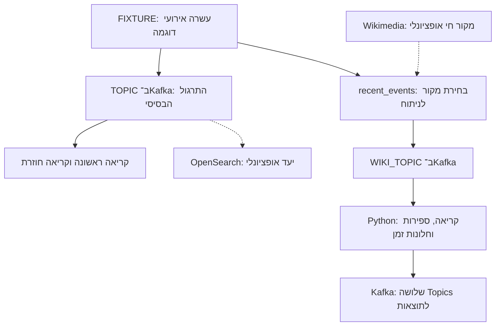

<div dir="rtl" lang="he">

# מה אנחנו עושים במחברת Kafka?

**מדריך מפורט למחברת Kafka עם Python — ד״ר פאול אברהמי**

[חזרה להוראות הפרויקט](../README.md) · [פתיחת המחברת](../Kafka_Python_Step_by_Step_HE.ipynb) · [פתרון תקלות חיבור](KAFKA_TROUBLESHOOTING_HE.md)

במחברת אנחנו בונים מעבדה שמדגימה את המסלול של אירוע: **יצירת נתון, שליחתו ל־Kafka, קריאתו על ידי צרכן, עיבודו ופרסום התוצאות בחזרה ל־Kafka.**

הדוגמה שלנו עוסקת באירועים שמייצגים שינויים בדפי Wikipedia. באמצעותם אנחנו לומדים גם את המנגנונים של Kafka וגם שאלות מעשיות: איך קוראים את אותם נתונים בכמה יישומים, מה עושים אחרי תקלה, ואיך הופכים אירועים בודדים לסיכומים לפי אתר ולפי זמן.

המדריך עובר לפי השלבים במחברת ומסביר גם את הפלטים. הוא מתייחס לקוד ב[גרסת המחברת שעליה עבדנו](https://github.com/paulavrahami/kafka-python-lesson/blob/1be968619f4d6cc95659b9055c9f2ddb9e1c5ee8/Kafka_Python_Step_by_Step_HE.ipynb).

**התצורה המרכזית המתוארת כאן היא:**

</div>

```python
RUN_LIVE_KAFKA = True
RUN_LIVE_WIKIMEDIA = False
RUN_LIVE_OPENSEARCH = False
```

<div dir="rtl" lang="he">

בתצורה הזאת **Kafka אמיתי פועל ב־Docker, ואנחנו שולחים אליו נתוני דוגמה שהמחברת יוצרת בעצמה**. החיבור ל־Wikimedia ול־OpenSearch נשאר כבוי.

בקובץ המחברת שבמאגר, ברירת המחדל של שלושת המתגים היא `False`. כדי לבצע את מסלול Kafka החי, משנים את ההגדרות כפי שמוצג לעיל. כשהכול כבוי, תרגילי Python המקומיים עדיין פועלים, אך אין שליחה או קריאה מול Kafka.

---

## 1. מה בדיוק פועל במחשב?

כדאי להפריד בין הרכיבים, כי לכל אחד תפקיד אחר:

| רכיב | התפקיד שלו במעבדה |
|---|---|
| **Cursor** | העורך שבו פותחים את המחברת ומפעילים את התאים. |
| **Python Kernel** | תהליך Python שמריץ את הקוד ושומר את המשתנים בזיכרון. |
| **uv** | מנהל את גרסת Python ואת החבילות של הפרויקט. |
| **Docker** | מפעיל את המכולה שבה נמצא שרת Kafka. |
| **Kafka Broker** | שרת Kafka שמקבל רשומות, שומר אותן ומאפשר לצרכנים לקרוא אותן. |
| **confluent-kafka** | ספריית Python שבאמצעותה המחברת מתקשרת עם שרת Kafka. |

כלומר, **ה־Producer, ה־Consumer וחישובי הסיכומים הם קוד Python במחברת. שרת Kafka הוא תהליך נפרד בתוך Docker.**

כשאנחנו אומרים “שלחנו הודעה ל־Kafka”, קוד Python פנה לשרת דרך `127.0.0.1:9092`. כשאנחנו אומרים “צרכנו הודעה”, קוד Python קיבל מהשרת רשומה שנשמרה בו.

## 2. התמונה הגדולה: שני מסלולים במחברת

במחברת יש שני מסלולים עיקריים. ההפרדה הזאת חשובה להבנת הקוד:

</div>



<div dir="rtl" lang="he">

הציור מתאר את המסלול שבו Kafka מופעל. הקווים המקווקווים הם הרחבות אופציונליות. השליחה ל־Topics מתבצעת באמצעות Producer, והקריאה מהם באמצעות Consumer.

**המסלול הראשון — `TOPIC` — מלמד את פעולות Kafka הבסיסיות:** שליחה, קריאה, שמירת התקדמות וקריאה חוזרת.

**המסלול השני — `WIKI_TOPIC` — מלמד עיבוד נתונים:** בוחרים מקור נתונים, מעבירים אותם דרך Kafka, קוראים אותם, מחשבים סיכומים ומפרסמים את הסיכומים.

אותם נתוני דוגמה משמשים את שני המסלולים כאשר Wikimedia כבוי. המסלול הראשון ממשיך להשתמש בנתונים הסינתטיים גם כאשר מפעילים את מקור Wikimedia במסלול השני.

---

## 3. שלב 1: מגדירים את הניסוי

בתחילת המחברת מגדירים את הסביבה ואת שלושת המתגים:

</div>

```python
RUN_LIVE_KAFKA = True
RUN_LIVE_WIKIMEDIA = False
RUN_LIVE_OPENSEARCH = False
```

<div dir="rtl" lang="he">

לכל מתג משמעות עצמאית:

- `RUN_LIVE_KAFKA` מפעיל יצירת Topics, שליחה וקריאה מול שרת Kafka.
- `RUN_LIVE_WIKIMEDIA` קובע אם מקור הנתונים לניתוח יהיה דגימה מהאינטרנט.
- `RUN_LIVE_OPENSEARCH` מפעיל כתיבת מסמכים לשרת OpenSearch שהוכן בנפרד.

לכן בהחלט אפשר לעבוד עם **Kafka אמיתי ונתונים סינתטיים**. זה המסלול שבו מתחילים, כי אפשר לדעת מראש מה אמורה להיות התוצאה.

### מהו RUN_ID?

כאשר Kafka מופעל, המחברת יוצרת מזהה קצר לניסוי, למשל:

</div>

```python
RUN_ID = "a1b2c3d4"
```

<div dir="rtl" lang="he">

המזהה מצטרף לשמות ה־Topics:

</div>

```text
python.demo.a1b2c3d4
python.wikimedia.recentchange.a1b2c3d4
```

<div dir="rtl" lang="he">

כך הרצה חדשה של תא ההגדרות יוצרת שמות חדשים לניסוי, ומקטינה ערבוב עם נתוני הרצות קודמות.

יש לכך השלכה מעשית: **הרצת כל המחברת מחדש והרצת תא Consumer בלבד הן פעולות שונות.** הראשונה יוצרת ניסוי חדש; השנייה יכולה להמשיך לעבוד עם אותו Topic ועם ההתקדמות שכבר נשמרה.

תא האבחון הבא מדפיס את גרסת Python, נתיב ה־Kernel וגרסאות החבילות. מטרתו לוודא שהמחברת רצה בסביבה שהתכוונו אליה.

---

## 4. שלב 2: יוצרים עשרה אירועים לדוגמה

המשתנה המרכזי הראשון הוא:

</div>

```python
FIXTURE
```

<div dir="rtl" lang="he">

זו רשימת Python שמכילה עשרה מילונים. כל מילון מתאר אירוע אחד.

לדוגמה, האירוע הראשון נראה כך:

</div>

```json
{
  "meta": {
    "id": "synthetic-001",
    "dt": "2026-11-21T12:00:02+00:00"
  },
  "server_name": "en.wikipedia.org",
  "bot": true,
  "type": "edit",
  "title": "Synthetic page 1",
  "synthetic": true
}
```

<div dir="rtl" lang="he">

המשמעות היא: לצורך התרגיל, אנחנו מדמיינים שבשעה `12:00:02 UTC` התרחשה עריכה באתר האנגלי, והיא מסומנת כפעולת Bot.

השדות החשובים הם:

- **`meta.id`** — מזהה האירוע.
- **`meta.dt`** — הזמן שבו האירוע התרחש לפי הנתונים.
- **`server_name`** — האתר שאליו האירוע שייך.
- **`bot`** — האם האירוע מסומן כפעולת Bot.
- **`synthetic`** — סימון מפורש שמדובר בנתון מומצא לתרגול.

אלה עשרת האירועים. כל הזמנים בטבלה הם **UTC**:

| אירוע | זמן | אתר | מסומן כ־Bot? |
|---|---|---|---|
| 001 | 12:00:02 | אנגלית | כן |
| 002 | 12:00:04 | אנגלית | לא |
| 003 | 12:00:08 | עברית | כן |
| 004 | 12:00:10 | אנגלית | כן |
| 005 | 12:00:12 | עברית | לא |
| 006 | 12:00:20 | אנגלית | כן |
| 007 | 12:00:25 | גרמנית | לא |
| 008 | 12:00:45 | עברית | כן |
| 009 | 12:01:01 | אנגלית | כן |
| 010 | 12:01:05 | עברית | לא |

מכאן אפשר לחשב מראש:

- חמישה אירועים באתר האנגלי.
- ארבעה באתר העברי.
- אחד באתר הגרמני.
- שישה מסומנים כ־Bot וארבעה אינם מסומנים כ־Bot.

**בחרנו נתונים קטנים וצפויים כדי שאפשר יהיה לבדוק אם הקוד מבצע את החישוב הנכון.**

---

## 5. שלב 3: מכינים את האירוע להעברה

בתוך Python האירוע הוא מילון. להעברה לשרת אנחנו מייצגים אותו כ־JSON ומקודדים אותו לבתים ב־UTF-8:

</div>

```python
value = json.dumps(event, ensure_ascii=False).encode("utf-8")
```

<div dir="rtl" lang="he">

בצד הקורא מפענחים בחזרה:

</div>

```python
event = json.loads(payload)
```

<div dir="rtl" lang="he">

המחברת בודקת שהקידוד והפענוח מחזירים את אותו אירוע:

</div>

```python
assert decoded == FIXTURE[0]
```

<div dir="rtl" lang="he">

### שלושה דברים שחשוב להבדיל ביניהם

| מושג | דוגמה | למה הוא משמש? |
|---|---|---|
| **מזהה האירוע** | `synthetic-001` | זיהוי אותו אירוע עסקי גם אם נשלח שוב. |
| **מפתח Kafka — Key** | `en.wikipedia.org` | קיבוץ אירועים קשורים לצורך חלוקה למחיצות. |
| **מיקום ב־Kafka** | Topic, Partition, Offset | זיהוי המקום שבו רשומה מסוימת נשמרה ביומן. |

במחברת בחרנו בשם האתר בתור המפתח:

</div>

```python
key = event["server_name"].encode("utf-8")
```

<div dir="rtl" lang="he">

לכן לחמשת האירועים מהאתר האנגלי יש אותו מפתח, אבל לכל אחד מהם מזהה אירוע אחר.

### ויש גם שני מושגים שונים של זמן

החלונות שנחשב בהמשך משתמשים ב־`meta.dt`, הזמן שבתוכן האירוע.

בשליחות שבמחברת אנחנו בדרך כלל לא מעבירים `timestamp_fn`, ולכן זמן רשומת Kafka נקבע באמצעות ברירת המחדל של ה־Producer. **הזמן הסינתטי שבתוך ה־JSON נשאר הנתון שעליו מבוסס הניתוח שלנו.**

כך אפשר לתרגל אירועים מזמנים קבועים, בלי לבלבל בין זמן האירוע בדוגמה לבין רגע השליחה בפועל.

---

## 6. שלב 4: יוצרים את המקומות שבהם הנתונים יישמרו

בשלב הזה משתמשים ב־`AdminClient` כדי להכין את ה־Topics.

**Topic הוא יומן רשומות בעל שם.** אנחנו בוחרים איזה סוג מידע נכתוב לכל Topic.

במחברת נוצרים חמישה Topics:

| משתנה | תוכן |
|---|---|
| `TOPIC` | עשרת אירועי הדוגמה לתרגול Kafka הבסיסי. |
| `WIKI_TOPIC` | האירועים שמהם נבצע את הניתוח. |
| `RESULT_TOPICS["bots"]` | סיכומי Bot / non-bot. |
| `RESULT_TOPICS["websites"]` | סיכומים לפי אתר וחלון של דקה. |
| `RESULT_TOPICS["timeseries"]` | סיכומים בחלונות של עשר שניות. |

לכל Topic אנחנו מגדירים:

</div>

```python
num_partitions = 3
replication_factor = 1
```

<div dir="rtl" lang="he">

**שלוש מחיצות** פירושן שהרשומות יכולות להתחלק לשלושה יומנים פנימיים של אותו Topic. **עותק אחד** פירושו שאין במעבדה עותק נוסף של המחיצה בשרת אחר. חלוקה למחיצות ושכפול הם מנגנונים שונים. [מקור: מבוא Apache Kafka](https://kafka.apache.org/intro/).

הפונקציה `ensure_topics()` מבצעת את ההכנה והבדיקות: חיבור לשרת, בדיקת הכתובות שהשרת מפרסם, יצירת Topics חסרים והמתנה למוכנות המחיצות.

לצורך הבנת השיעור, התפקיד שלה הוא:

> לפני שאנחנו שולחים אירועים, לוודא שה־Topic שאליו נשלח קיים ומוכן לקבל אותם.

---

## 7. שלב 5: שולחים אירועים באמצעות Producer

כעת מפעילים:

</div>

```python
delivery_report = publish_json_rows(
    FIXTURE,
    TOPIC,
    key_fn=lambda event: event["server_name"],
    limit=MAX_MESSAGES,
)
```

<div dir="rtl" lang="he">

כלומר: קח את אירועי הדוגמה, ושלח עד עשרה מהם ל־`TOPIC`, כאשר שם האתר הוא המפתח.

הביטוי:

</div>

```python
lambda event: event["server_name"]
```

<div dir="rtl" lang="he">

הוא פונקציה קטנה שאומרת: “מתוך האירוע שקיבלת, החזר את שם האתר”.

### מה קורה בתוך פונקציית השליחה?

לכל אירוע הפונקציה מכינה מפתח ו־JSON, ומפעילה `produce()`.

השליחה היא אסינכרונית: התוצאה הסופית מגיעה באמצעות פונקציית Callback. פעולות `poll()` ו־`flush()` מאפשרות ללקוח לטפל באישורי המסירה ובשגיאות. [מקור: Confluent Python API](https://docs.confluent.io/platform/current/clients/confluent-kafka-python/html/index.html).

לכן אנחנו אוספים שני מספרים:

</div>

```python
{
    "accepted": 10,
    "confirmed": 10
}
```

<div dir="rtl" lang="he">

- **`accepted`** — כמה רשומות התקבלו לתור השליחה המקומי.
- **`confirmed`** — כמה רשומות קיבלו אישור מסירה מוצלח.

בנוסף, `records` מכילה פרטי מסירה, ובהם המחיצה וה־Offset האמיתיים שקיבלה כל רשומה.

**האישור הזה אומר שהשליחה ל־Kafka הצליחה. הוא עדיין אינו אומר שצרכן כלשהו עיבד את האירוע.** קריאת האירועים היא השלב הבא.

---

## 8. שלב 6: מבינים מפתחות ומחיצות

כאן אנחנו בוחנים את חמשת האירועים מהאתר האנגלי.

לכולם יש:

</div>

```text
Key = en.wikipedia.org
```

<div dir="rtl" lang="he">

המחברת בודקת תחילה שהמפתחות אכן זהים. במסלול החי היא בודקת גם את דוח המסירה, כדי לראות לאילו מחיצות האירועים הגיעו.

כאשר הגדרות החלוקה ומספר המחיצות נשארים קבועים, אותו מפתח משמש לשמירת הזיקה למחיצה. הסדר ש־Kafka מספק הוא סדר בתוך מחיצה; אין כאן סדר כולל אחד בין כל המחיצות. [מקור: מבוא Apache Kafka](https://kafka.apache.org/intro/).

למה זה שימושי?

אם נרצה לעבד ברצף את האירועים של אותו לקוח, אפשר לבחור `customer_id` כמפתח. במקרה שלנו אנחנו מקבצים לפי אתר.

עם זאת, **מפתחות שונים יכולים להגיע לאותה מחיצה**. שלושה אתרים ושלוש מחיצות אינם מבטיחים “מחיצה אחת לכל אתר”.

בתרגיל שבמחברת אנחנו גם חושבים על חלוקת עבודה: בקבוצת צרכנים רגילה, Topic עם שלוש מחיצות יכול להקצות מחיצות לכל היותר לשלושה צרכנים באותה קבוצה. צרכן רביעי עשוי להישאר ללא מחיצה.

---

## 9. שלב 7: קוראים את האירועים באמצעות Consumer

כעת המחברת קוראת מה־Topic:

</div>

```python
receipts = consume_events(
    TOPIC,
    "python-students-a",
    remember,
    MAX_MESSAGES,
    READ_DEADLINE_SECONDS,
)
```

<div dir="rtl" lang="he">

הפרמטרים אומרים:

- קרא מ־`TOPIC`.
- השתמש בקבוצת הצרכנים `python-students-a`.
- עבור כל אירוע, הפעל את `remember`.
- קרא עד עשר רשומות, במסגרת מגבלת לולאת הקריאה.

הפונקציה `remember()` מוסיפה את האירוע לרשימה:

</div>

```python
observed_events
```

<div dir="rtl" lang="he">

### מה עושה הצרכן לכל רשומה?

הסדר בקוד הוא:

1. קורא רשומה מ־Kafka.
2. מפענח את ה־JSON.
3. מפעיל את פעולת העיבוד — כאן `remember`.
4. מבצע Commit.
5. מוסיף אישור לרשימת `receipts`.

העיקרון הוא **לשמור התקדמות אחרי הצלחת העיבוד**.

### מהו Commit?

Commit שומר את מיקום ההמשך של קבוצת הצרכנים במחיצה. בשימוש שבמחברת, Commit על הודעה ב־Offset מסוים שומר את ה־Offset הבא. לדוגמה, אחרי טיפול מוצלח ברשומה ב־Offset `7`, מיקום ההמשך הוא `8`. [מקור: Confluent Python API — commit](https://docs.confluent.io/platform/current/clients/confluent-kafka-python/html/index.html#confluent_kafka.Consumer.commit).

זה אינו מונה כולל של כל ה־Topic: לכל מחיצה מיקום משלה.

כאשר מופיע:

</div>

```text
LIVE processed and committed: 10
```

<div dir="rtl" lang="he">

המשמעות היא שעשר רשומות נקראו, פעולת העיבוד שלהן הסתיימה, ונשמרה עבורן התקדמות.

בשלב הזה פעולת העיבוד היא שמירה ברשימת Python. בהמשך משתמשים באותה פונקציית צריכה עם פעולת עיבוד אחרת.

---

## 10. שלב 8: קוראים שוב את אותם אירועים

כאן לומדים למה קבוצות צרכנים חשובות.

נניח שקבוצה A קראה את כל עשרת האירועים ושמרה התקדמות. אם נפעיל שוב את אותה קבוצה על אותו Topic, היא יכולה להמשיך מהמיקום ששמרה.

לעומת זאת, המחברת יוצרת קבוצה חדשה:

</div>

```text
python-replay-<random-id>
```

<div dir="rtl" lang="he">

לקבוצה החדשה אין התקדמות קודמת באותו Topic, ולכן היא יכולה לקרוא את ההיסטוריה הזמינה לפי מדיניות ההתחלה שלה.

### מה אומר earliest?

ההגדרה:

</div>

```python
"auto.offset.reset": "earliest"
```

<div dir="rtl" lang="he">

קובעת להתחיל מהמיקום המוקדם הזמין כאשר אין מיקום שמור תקף. היא אינה מאפסת בכל הפעלה קבוצה שכבר שמרה התקדמות. [מקור: הגדרות Consumer של Apache Kafka](https://kafka.apache.org/44/configuration/consumer-configs/).

זו הסיבה לשני פלטים שונים אפשריים:

- אותה קבוצה שכבר סיימה — עשויה לקרוא אפס אירועים נוספים.
- קבוצה חדשה — יכולה לקרוא שוב את עשרת האירועים.

קריאת אירוע אינה מוחקת אותו. זמינותו לקריאה חוזרת תלויה במדיניות השמירה ובמה שעדיין קיים ב־Topic. [מקור: מבוא Apache Kafka](https://kafka.apache.org/intro/).

היכולת הזאת מאפשרת לכמה יישומים להשתמש באותם אירועים, כאשר לכל אחד התקדמות משלו.

---

## 11. שלב 9: מדמים תקלה בין כתיבה לשמירת התקדמות

זה אחד החלקים החשובים במחברת להבנת מערכות נתונים.

**הניסוי הזה מתבצע כולו בזיכרון Python, גם כשה־Kafka החי מופעל.**

אנחנו מגדירים:

</div>

```python
documents = {}
checkpoint = {"next_offset": 0}
```

<div dir="rtl" lang="he">

המילון `documents` מדמה מאגר מסמכים. `checkpoint` מדמה את מיקום ההמשך.

לכל אירוע עושים שתי פעולות:

</div>

```python
documents[document_id] = event
checkpoint["next_offset"] = offset + 1
```

<div dir="rtl" lang="he">

כעת אנחנו יוצרים במכוון תקלה **אחרי כתיבת האירוע הרביעי, ולפני עדכון ההתקדמות שלו**.

מכיוון שהספירה מתחילה באפס, האירוע הרביעי נמצא ב־Offset `3`.

בנקודת התקלה:

- ארבעה מסמכים כבר נכתבו.
- מיקום ההמשך עדיין מצביע על `3`.
- כלומר, המערכת עדיין אינה יודעת שהאירוע הרביעי הושלם.

כשקוראים שוב ל־`process_offline()`, האירוע הרביעי מעובד שוב.

### אז למה נשארים רק עשרה מסמכים?

כי המפתח במילון הוא מזהה האירוע:

</div>

```python
documents["synthetic-004"] = event
```

<div dir="rtl" lang="he">

הכתיבה השנייה משתמשת באותו מזהה, ולכן מעדכנת את אותה רשומה במילון.

התוצאה היא:

</div>

```text
10 unique documents
11 write attempts
Event 004 attempts: 2
```

<div dir="rtl" lang="he">

**האירוע עובד פעמיים, אבל התוצאה הסופית כוללת מסמך אחד עבורו.**

זה מלמד למה מזהה יציב חשוב כאשר פעולה עלולה להתבצע שוב. הפעולה הזאת מתאימה לעדכון מסמך לפי מזהה; בפעולות כמו חיוב כספי או שליחת הודעה צריך לתכנן מניעת כפילויות שמתאימה לפעולה.

המילה `restart` בפלט של הניסוי פירושה קריאה חוזרת לפונקציה. אין צורך לאתחל את ה־Kernel באמצע — אתחול שלו ימחק את המילונים שבהם אנחנו משתמשים בניסוי.

---

## 12. שלב 10: הרחבה אופציונלית ל־OpenSearch

כאן מחליפים את פעולת העיבוד של הצרכן.

בשלב 7 הצרכן הפעיל:

</div>

```python
remember(event)
```

<div dir="rtl" lang="he">

בשלב OpenSearch הוא מפעיל:

</div>

```python
index_event(client, event)
```

<div dir="rtl" lang="he">

כלומר, במקום לשמור ברשימת Python, הוא כותב מסמך למנוע החיפוש.

מזהה המסמך הוא שוב:

</div>

```python
event["meta"]["id"]
```

<div dir="rtl" lang="he">

ב־OpenSearch, פעולת Index עם מזהה קיים מעדכנת את המסמך הקיים. זו ההתנהגות שהדגמנו קודם באמצעות מילון. [מקור: OpenSearch Index Document API](https://docs.opensearch.org/latest/api-reference/document-apis/index-document/).

ה־Commit מתבצע לאחר שהכתיבה אושרה.

אם ההגדרה נשארה:

</div>

```python
RUN_LIVE_OPENSEARCH = False
```

<div dir="rtl" lang="he">

החיבור הזה דולג.

עוד פרט חשוב: **הקוד שסיפקנו ל־OpenSearch קורא מ־`TOPIC`, מסלול הדוגמה הראשון.** הוא אינו קורא אוטומטית מה־Topic של ניתוח Wikimedia.

---

## 13. שלבים 11–12: בוחרים מקור נתונים לניתוח

כאן מתחיל המסלול השני של המחברת.

### שלב 11 — הכנה לקליטה מ־Wikimedia

Wikimedia מציעה שירות אירועים דרך HTTP בפרוטוקול SSE — Server-Sent Events. [מקור: Wikimedia EventStreams](https://wikitech.wikimedia.org/wiki/Event_Platform/EventStreams).

במחברת מגדירים שתי פונקציות:

- `parse_sse_blocks()` — מפרקת את הטקסט שמגיע מהשירות לאירועים.
- `read_wikimedia_events()` — מבצעת את בקשת הרשת ואוספת דגימה מוגבלת.

הפענוח מתייחס, בין היתר, לשורה ריקה שמסיימת אירוע, לשורות `data:` ולשורות הערה שמתחילות בנקודתיים. כללי המבנה האלה מגיעים מפרוטוקול SSE. [מקור: תקן HTML — Server-Sent Events](https://html.spec.whatwg.org/multipage/server-sent-events.html).

אנחנו בודקים את המפענח תחילה באמצעות טקסט שנוצר מקומית. כך אפשר ללמוד ולבדוק את הפענוח בלי להיות תלויים בחיבור לאינטרנט.

**תא שמכיל `def read_wikimedia_events(...)` רק מגדיר את הפונקציה. החיבור מתרחש כשקוראים לה.**

### שלב 12 — בחירת המקור

הבחירה נעשית כאן:

</div>

```python
if RUN_LIVE_WIKIMEDIA:
    recent_events = read_wikimedia_events(limit=MAX_MESSAGES)
else:
    recent_events = copy.deepcopy(FIXTURE)
```

<div dir="rtl" lang="he">

אם Wikimedia כבוי, `recent_events` מקבל עותק של עשרת אירועי הדוגמה.

אם הוא מופעל, המשתנה מקבל דגימה מהשירות החי.

### ואז מעבירים את הדגימה דרך Kafka

כאשר Kafka מופעל:

1. שולחים את `recent_events` ל־`WIKI_TOPIC`.
2. יוצרים קבוצת צרכנים חדשה לניתוח.
3. קוראים מה־Topic.
4. שומרים את האירועים שנקראו ברשימה:

</div>

```python
ANALYSIS_EVENTS
```

<div dir="rtl" lang="he">

**זוהי הרשימה שממנה מחושבים הסיכומים בהמשך.**

לכן במסלול החי הניתוח משתמש במה שנקרא מ־Kafka. אם הצרכן קרא רק חלק מהדגימה, החישובים יתבססו על החלק שנקרא.

כאשר Kafka כבוי, הרשימה הזאת מקבלת ישירות עותק מקומי של `recent_events`.

---

## 14. שלב 13: סופרים אירועים לפי סימון Bot

כעת מתחיל העיבוד האנליטי.

הפונקציה:

</div>

```python
classify_bot(event)
```

<div dir="rtl" lang="he">

בודקת את השדה `bot` ומחזירה:

</div>

```text
bot
non-bot
invalid
```

<div dir="rtl" lang="he">

הסיווג מבוסס על ערך שכבר קיים באירוע. אין כאן מודל שמנסה לזהות התנהגות של Bot.

הספירה נעשית באמצעות:

</div>

```python
bot_counts = Counter(
    classify_bot(event)
    for event in ANALYSIS_EVENTS
)
```

<div dir="rtl" lang="he">

אם כל עשרת האירועים הסינתטיים נקראו, התוצאה היא:

</div>

```python
{
    "bot": 6,
    "non-bot": 4
}
```

<div dir="rtl" lang="he">

לאחר מכן בונים שתי שורות סיכום:

</div>

```python
bot_rows = [
    {"category": "bot", "count": 6},
    {"category": "non-bot", "count": 4},
]
```

<div dir="rtl" lang="he">

ההבדל בין שני המספרים חשוב:

- `6` הוא מספר האירועים המסומנים כ־Bot.
- `2` הוא מספר שורות הסיכום ב־`bot_rows`.

---

## 15. שלב 14: סופרים אירועים בחלונות זמן

ספירה כוללת עונה על השאלה “כמה אירועים היו?”. חלונות זמן מאפשרים לשאול גם “מתי הם התרחשו?”.

במחברת מבצעים שני חישובים.

### א. כמה אירועים היו בכל אתר, בכל דקה?

</div>

```python
site_rows = aggregate_windows(
    ANALYSIS_EVENTS,
    60,
    lambda event: event["server_name"],
)
```

<div dir="rtl" lang="he">

אנחנו מקבצים לפי שילוב של:

</div>

```text
Website + window start
```

<div dir="rtl" lang="he">

כלומר, שם האתר ותחילת חלון הדקה.

עבור עשרת אירועי הדוגמה המלאים מתקבלות חמש שורות:

| אתר | תחילת חלון ב־UTC | מספר אירועים |
|---|---|---:|
| גרמנית | 12:00:00 | 1 |
| אנגלית | 12:00:00 | 4 |
| אנגלית | 12:01:00 | 1 |
| עברית | 12:00:00 | 3 |
| עברית | 12:01:00 | 1 |

סכום הספירות הוא עדיין עשרה.

### ב. כמה אירועים מכל האתרים היו בכל עשר שניות?

</div>

```python
time_rows = aggregate_windows(
    ANALYSIS_EVENTS,
    10,
    lambda event: "all",
)
```

<div dir="rtl" lang="he">

כאן המפתח הוא תמיד `"all"`, ולכן אנחנו מאחדים את כל האתרים ומקבצים רק לפי חלון הזמן.

| תחילת חלון ב־UTC | סוף החלון, שאינו נכלל בו | מספר אירועים |
|---|---|---:|
| 12:00:00 | 12:00:10 | 3 |
| 12:00:10 | 12:00:20 | 2 |
| 12:00:20 | 12:00:30 | 2 |
| 12:00:40 | 12:00:50 | 1 |
| 12:01:00 | 12:01:10 | 2 |

לכן מתקבל:

</div>

```python
[3, 2, 2, 1, 2]
```

<div dir="rtl" lang="he">

החלון הראשון כולל את האירועים בשניות `02`, `04` ו־`08`.

האירוע בשנייה `10` שייך לחלון הבא. הגבול התחתון נכלל בחלון; הגבול העליון אינו נכלל בו.

### איך הקוד מוצא את תחילת החלון?

הוא מעגל את זמן האירוע כלפי מטה לכפולה של רוחב החלון. בכתיב הסברי:

</div>

```python
start = (event_time_ms // window_width_ms) * window_width_ms
```

<div dir="rtl" lang="he">

לדוגמה, בחלון של עשר שניות, זמן `12:00:12` שייך לחלון שמתחיל ב־`12:00:10`.

חלונות שאין בהם אירועים אינם מופיעים ברשימת התוצאות. כדי להציג אותם עם אפס נדרשת השלמה נוספת.

**החישובים האלה מתבצעים ב־Python על הרשימה שנקראה. המחברת מחשבת תמונת מצב של דגימה מוגבלת.** זו אינה הפעלה של מנוע Kafka Streams או של שירות עיבוד רציף.

---

## 16. שלב 15: מה קורה לאירוע שמגיע מאוחר?

כאן אנחנו בודקים את ההבדל בין **זמן האירוע** לבין **סדר הגעתו**.

אנחנו לוקחים את אירועי הדוגמה, ובסוף הרשימה מוסיפים אירוע שזמנו:

</div>

```text
12:00:03
```

<div dir="rtl" lang="he">

כלומר, הוא נוסף אחרי שכבר ראינו אירועים מ־`12:01:05`, אבל לפי הזמן שלו הוא שייך לחלון הראשון.

לפני הוספתו היו בחלון הראשון שלושה אירועים. לאחר חישוב מחדש מתקבלים ארבעה:

</div>

```text
Recomputed first window count: 4
```

<div dir="rtl" lang="he">

למה?

כי פונקציית הסיכום עוברת על כל הרשימה ומשייכת כל אירוע לפי `meta.dt`, בלי קשר למיקומו ברשימה.

**האירוע המאוחר הזה שייך לניסוי נפרד:** הוא אינו נוסף ל־`ANALYSIS_EVENTS`, אינו נשלח ל־Kafka, ואינו משנה את שלושת הסיכומים שנפרסם בסוף.

המטרה הלימודית היא להבין שבמערכת רציפה צריך להחליט מה לעשות עם אירוע שמגיע אחרי שכבר פרסמנו סיכום לחלון שלו: לעדכן את הסיכום, לאפשר איחור מוגבל, או לטפל בו במסלול נפרד.

באותו אזור במחברת יש גם תרגיל נוסף: מסננים רק אירועי Bot מתוך `FIXTURE`, ואז סופרים אותם לפי אתר ודקה.

---

## 17. שלב 16: מפרסמים את הסיכומים בחזרה ל־Kafka

עכשיו יש לנו שלוש רשימות תוצאה:

</div>

```python
bot_rows
site_rows
time_rows
```

<div dir="rtl" lang="he">

המחברת שולחת כל רשימה ל־Topic המתאים.

עבור הדגימה הסינתטית המלאה:

| Topic תוצאה | מה נכתב אליו? | מספר רשומות סיכום |
|---|---|---:|
| Bots | שורה עבור `bot` ושורה עבור `non-bot` | 2 |
| Websites | שורה לכל שילוב של אתר ודקה שהופיע | 5 |
| Timeseries | שורה לכל חלון של עשר שניות שאינו ריק | 5 |

לכן הפלט האחרון הוא:

</div>

```python
{
    "bots": 2,
    "websites": 5,
    "timeseries": 5
}
```

<div dir="rtl" lang="he">

**הפלט הזה סופר הודעות סיכום שנמסרו ל־Kafka.**

ב־Topic של ה־Bots יש שתי הודעות, שתוכנן הוא:

</div>

```json
{"category": "bot", "count": 6}
```

```json
{"category": "non-bot", "count": 4}
```

<div dir="rtl" lang="he">

כך אנחנו מדגימים שיישום יכול להיות גם Consumer וגם Producer: הוא קורא אירועים גולמיים, מחשב תוצאה ומפרסם אירועים חדשים שמייצגים את התוצאה.

במחברת הנוכחית אנחנו מסתיימים בפרסום הסיכומים. אפשר לחבר בהמשך יישום נוסף שיקרא אותם ויציג Dashboard, יפיק התראה או יפעיל תהליך אחר.

---

## 18. מה אמורים לראות בהרצה המלאה?

אם Wikimedia כבוי, Kafka מופעל, וכל עשרת האירועים נקראו, אלה הפלטים המרכזיים:

| פלט | המשמעות |
|---|---|
| `confirmed: 10` בשלב 5 | עשרת אירועי הדוגמה נמסרו ל־Topic הראשון. |
| `LIVE processed and committed: 10` | הצרכן הראשון עיבד עשר רשומות ושמר התקדמות. |
| `records: 10` בקבוצת Replay | קבוצה חדשה קראה שוב את האירועים. |
| `10 unique documents`, `11 write attempts` | ניסוי התקלה הדגים עיבוד חוזר של האירוע הרביעי. |
| `LIVE Kafka sample for analysis: 10` | עשרה אירועים נקראו מה־Topic של הניתוח. |
| `bot: 6`, `non-bot: 4` | התפלגות עשרת האירועים לפי סימון Bot. |
| `bots: 2`, `websites: 5`, `timeseries: 5` | מספר הודעות הסיכום שפורסמו בסוף. |

ההגעה לסוף המחברת אומרת שהתאים לא נעצרו בשגיאה. **המספרים בפלטי הצריכה הם שמראים כמה אירועים התקבלו בפועל**, משום שקריאה מוגבלת בזמן יכולה להסתיים גם עם דגימה חלקית.

אם Wikimedia הופעל, הספירות והחלונות תלויים בדגימה שהתקבלה, ולכן לא מצפים דווקא ל־`6/4` או ל־`2/5/5`.

---

## 19. איפה נמצאים הנתונים אחרי ההרצה?

יש שני מקומות עיקריים:

**בזיכרון Python** נמצאים המשתנים כמו:

</div>

```python
FIXTURE
observed_events
ANALYSIS_EVENTS
bot_rows
site_rows
time_rows
```

<div dir="rtl" lang="he">

אתחול ה־Kernel מוחק את המשתנים האלה, וצריך להריץ מחדש את התאים שמייצרים אותם.

**בשרת Kafka** נמצאות הרשומות שנשלחו ל־Topics. אתחול ה־Kernel אינו מוחק אותן. זמינותן בהמשך תלויה גם במכולה ובמדיניות השמירה.

זו אחת הסיבות לשימוש ב־Kafka: הנתונים שנמסרו אליו יכולים לשמש יישומים אחרים, גם מעבר למשך החיים של תהליך Python שיצר אותם.

---

## 20. איך זה מתחבר למערכת של סוכני AI?

המחברת נותנת את התשתית להבנת ארכיטקטורה מבוססת אירועים בקורס AI Engineering.

לדוגמה, אפשר להחליף את אירוע העריכה ב־Wikipedia באירוע עסקי:

</div>

```json
{
  "event_id": "evt-123",
  "event_type": "LoanRequestSubmitted",
  "customer_id": "customer-42",
  "request_id": "request-987"
}
```

<div dir="rtl" lang="he">

אז אפשר להגדיר:

- יישום שמפרסם את בקשת ההלוואה — Producer.
- סוכן שבודק מסמכים — Consumer בקבוצה אחת.
- סוכן שמנתח התאמה למדיניות — Consumer בקבוצה אחרת.
- סוכן שמפיק הסבר — Consumer בקבוצה נוספת.
- אירועי תוצאה כמו “חסרים מסמכים” או “הבדיקה הושלמה” — רשומות ב־Topics נוספים.

זו דוגמה להרחבה עתידית. מבנה האירוע העסקי שונה ממבנה אירועי הדוגמה, ולכן כדי לממש אותה נדרש להתאים גם את אימות השדות, את המפתח ואת פעולות העיבוד.

במחברת פעולות העיבוד פשוטות: שמירה ברשימה, סיווג לפי שדה וספירה. במערכת סוכנים, אותה נקודת עיבוד יכולה להפעיל לוגיקה מורכבת יותר. שמירת התקדמות, טיפול בכשל ומניעת כפילויות נשארים חלק מהתכנון.

**במעבר נוסף על המחברת, עקבו אחרי אירוע אחד — `synthetic-001`:** הוא נוצר כמילון, מקודד ל־JSON, נכתב ל־Kafka ונקרא בחזרה. במסלול הניתוח הוא מוסיף אחד לספירת ה־Bots, אחד לספירת האתר האנגלי בדקה הראשונה ואחד לחלון עשר השניות הראשון. זה החיבור בין הרשומה הבודדת לבין התוצאות שרואים בסוף.

---

## מקורות וקריאה נוספת

- [מחברת השיעור בפרויקט](../Kafka_Python_Step_by_Step_HE.ipynb).
- [Apache Kafka — מבוא, Topics, מחיצות ושכפול](https://kafka.apache.org/intro/).
- [Confluent Python API — Producer, Consumer ו־AdminClient](https://docs.confluent.io/platform/current/clients/confluent-kafka-python/html/index.html).
- [Apache Kafka — הגדרות Consumer](https://kafka.apache.org/44/configuration/consumer-configs/).
- [Wikimedia EventStreams](https://wikitech.wikimedia.org/wiki/Event_Platform/EventStreams).
- [תקן HTML — Server-Sent Events](https://html.spec.whatwg.org/multipage/server-sent-events.html).
- [OpenSearch — Index Document API](https://docs.opensearch.org/latest/api-reference/document-apis/index-document/).

</div>

