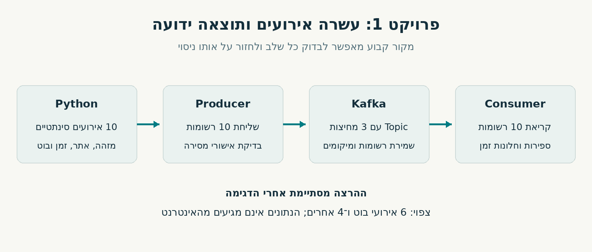
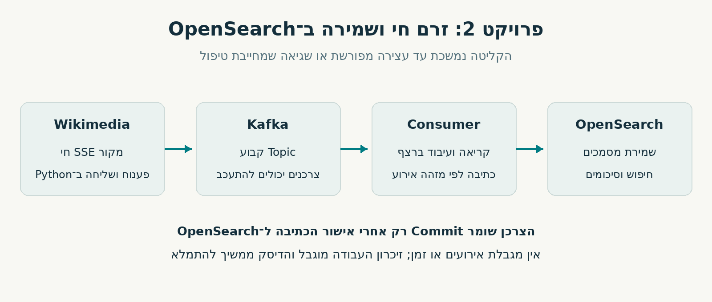

<div dir="rtl" lang="he" align="right">
<h1 dir="rtl" align="right">מדריך מפורט: מעשרה אירועים ידועים לזרם Wikimedia רציף</h1>
<p dir="rtl" align="right"><strong>ד״ר פאול אברהמי · Kafka בפייתון · Cursor ו־uv · Python 3.13.12</strong></p>
<p dir="rtl" align="right">המטרה היא להבין מה קורה לכל אירוע מהרגע שהוא נוצר ועד שאפשר לחפש אותו. נבנה את ההבנה בשני פרויקטים: תחילה עשרה אירועים מומצאים עם תשובות ידועות מראש, ואחר כך זרם ציבורי אמיתי שעובר דרך Kafka ונשמר ב־OpenSearch.</p>
<table dir="rtl" width="100%">
<thead><tr>
<th dir="rtl" align="right">פרויקט</th>
<th dir="rtl" align="right">מקור וכמות</th>
<th dir="rtl" align="right">מה מריצים?</th>
<th dir="rtl" align="right">תוצאה</th>
</tr></thead><tbody>
<tr><td dir="rtl" align="right"><a href="../01_Kafka_Synthetic_HE.ipynb">1. יסודות Kafka</a></td><td dir="rtl" align="right">עשרה אירועים סינתטיים קבועים.</td><td dir="rtl" align="right">הרצה סופית; Kafka אמיתי כברירת מחדל.</td><td dir="rtl" align="right">הוכחת מסירה וקריאה, Replay, ספירות וחלונות.</td></tr>
<tr><td dir="rtl" align="right"><a href="../02_Wikimedia_Streaming_OpenSearch_HE.ipynb">2. Wikimedia Streaming</a></td><td dir="rtl" align="right">מקור חי; אין תקרת כמות או זמן כוללת.</td><td dir="rtl" align="right">קליטה וצריכה במקביל, עד עצירה ידנית.</td><td dir="rtl" align="right">מסמכים ב־OpenSearch וחיפוש וסיכום שלהם.</td></tr>
</tbody></table>
<p dir="rtl" align="right">אין צורך ללמוד את כל קובצי העזר מראש. קראו תא הסבר, הריצו את תא הקוד שאחריו, והשוו את הפלט לציפייה המתוארת כאן. הקוד המשותף נמצא בתיקייה <code dir="ltr">scripts</code> כדי שתאי המחברת יישארו קצרים וברורים.</p>
</div>

<div dir="rtl" lang="he" align="right">
<h2 dir="rtl" align="right">א. אילו רכיבים פועלים במחשב?</h2>
<table dir="rtl" width="100%">
<thead><tr>
<th dir="rtl" align="right">רכיב</th>
<th dir="rtl" align="right">מה הוא עושה במעבדה?</th>
</tr></thead><tbody>
<tr><td dir="rtl" align="right">Cursor וה־Kernel</td><td dir="rtl" align="right">Cursor מציג את המחברת. ה־Kernel הוא תהליך Python שמריץ את התאים ושומר משתנים בזיכרון.</td></tr>
<tr><td dir="rtl" align="right">uv</td><td dir="rtl" align="right">מכין את Python 3.13.12 ואת סביבת החבילות .venv על פי uv.lock.</td></tr>
<tr><td dir="rtl" align="right">Producer ו־Consumer</td><td dir="rtl" align="right">קוד Python שמשתמש בלקוח confluent-kafka כדי לשלוח רשומות ולקרוא אותן.</td></tr>
<tr><td dir="rtl" align="right">Kafka ב־Docker</td><td dir="rtl" align="right">שרת נפרד מה־Kernel. שומר רשומות ב־Topics ומאפשר לקבוצות צרכנים לקרוא אותן.</td></tr>
<tr><td dir="rtl" align="right">Wikimedia EventStreams</td><td dir="rtl" align="right">מקור אירועים ציבורי באינטרנט. פעיל רק בפרויקט השני.</td></tr>
<tr><td dir="rtl" align="right">OpenSearch ב־Docker</td><td dir="rtl" align="right">שומר מסמכים ומבצע חיפוש וסיכומים. פעיל בפרויקט השני.</td></tr>
</tbody></table>
<p dir="rtl" align="right">התקנת חבילת Python אינה מפעילה שרת. לכן מכינים את .venv ובנפרד מפעילים Docker. לפרויקט הראשון מספיק Kafka; לשני דרושים גם OpenSearch וחיבור למקור Wikimedia.</p>
<p dir="rtl" align="right">להוראות Windows, הורדה ופקודות התקנה מלאות: <a href="../Kafka_Installation_Guide_HE.html">מדריך ההתקנה המקומי</a>. לאחר פתיחת Docker Desktop, אלה פקודות ההכנה מתוך תיקיית הפרויקט:</p>
</div>

```powershell
uv python install 3.13.12
uv sync --locked
uv run --locked python scripts/kafka_docker.py start
uv run --locked python scripts/check_kafka.py
uv run --locked python scripts/opensearch_docker.py start
```

<div dir="rtl" lang="he" align="right">
<p dir="rtl" align="right">בחרו בכל מחברת את <code dir="ltr">.venv\Scripts\python.exe</code> כ־Kernel ב־Windows. תא ההגדרות מציג את Python ואת הנתיב בפועל. את הפקודות לעיל מריצים במסוף; קוד Python מריצים בתאי המחברת.</p>
</div>

<div dir="rtl" lang="he" align="right">
<h2 dir="rtl" align="right">ב. המושגים שנראה בקוד</h2>
<table dir="rtl" width="100%">
<thead><tr>
<th dir="rtl" align="right">מושג</th>
<th dir="rtl" align="right">הסבר ודוגמה</th>
</tr></thead><tbody>
<tr><td dir="rtl" align="right">אירוע</td><td dir="rtl" align="right">תיאור של פעולה עם מזהה וזמן. לדוגמה: שינוי בדף מסוים באתר מסוים.</td></tr>
<tr><td dir="rtl" align="right">Broker</td><td dir="rtl" align="right">שרת Kafka. במעבדה פועל Broker יחיד בכתובת <code dir="ltr">127.0.0.1:9092</code>.</td></tr>
<tr><td dir="rtl" align="right">Topic</td><td dir="rtl" align="right">שם של רצף רשומות המחולק למחיצות. בפרויקט 1 השם חדש בכל ניסוי; בפרויקט 2 הוא קבוע.</td></tr>
<tr><td dir="rtl" align="right">Partition — מחיצה</td><td dir="rtl" align="right">רשימה מסודרת בתוך Topic. יש שלוש מחיצות במעבדה. סדר מובטח בתוך מחיצה; אין סדר כולל בין מחיצות.</td></tr>
<tr><td dir="rtl" align="right">Key — מפתח</td><td dir="rtl" align="right">ערך שמשפיע על בחירת המחיצה. כאן המפתח הוא שם האתר, למשל <code dir="ltr">he.wikipedia.org</code>.</td></tr>
<tr><td dir="rtl" align="right">Value — ערך</td><td dir="rtl" align="right">תוכן האירוע, שנשלח כ־JSON בקידוד UTF-8.</td></tr>
<tr><td dir="rtl" align="right">Event ID</td><td dir="rtl" align="right">המזהה העסקי <code dir="ltr">meta.id</code>. מאפשר לזהות את אותו אירוע גם כאשר הוא נקרא שוב.</td></tr>
<tr><td dir="rtl" align="right">Offset</td><td dir="rtl" align="right">מיקום רשומה בתוך מחיצה. כדי לזהות רשומה ב־Kafka צריך Topic, מספר מחיצה ו־Offset יחד.</td></tr>
<tr><td dir="rtl" align="right">Consumer Group</td><td dir="rtl" align="right">קבוצת צרכנים עם התקדמות שמורה משלה. קבוצות שונות יכולות לקרוא את אותן רשומות באופן עצמאי.</td></tr>
<tr><td dir="rtl" align="right">Commit</td><td dir="rtl" align="right">שמירת מיקום ההמשך של הקבוצה בכל מחיצה לאחר העיבוד. הוא אינו מוחק את הרשומה ואינו מאשר בעצמו כתיבה ל־OpenSearch.</td></tr>
</tbody></table>
<p dir="rtl" align="right">למשל, אם עובדה רשומה ב־Offset 7 במחיצה מסוימת, שמירת ההמשך היא בדרך כלל Offset 8 באותה מחיצה. במחיצה אחרת עשוי להיות מיקום אחר לגמרי. אין מונה יחיד של התקדמות לכל Topic.</p>
<p dir="rtl" align="right">מפתחות זהים מגיעים לאותה מחיצה כאשר כללי החלוקה ומספר המחיצות קבועים. מפתחות שונים יכולים להגיע לאותה מחיצה. שלושה אתרים אינם מבטיחים חלוקה של אתר אחד בכל מחיצה. שלוש מחיצות גם אינן שלושה עותקי גיבוי; במעבדה <code dir="ltr">replication.factor=1</code>.</p>
<p dir="rtl" align="right">להרחבה: <a href="https://kafka.apache.org/intro/">מבוא Apache Kafka</a> ו־<a href="https://docs.confluent.io/kafka-clients/python/current/overview.html">התיעוד של לקוח Python, קבוצות צרכנים ואישורי מסירה</a>.</p>
</div>

<div dir="rtl" lang="he" align="right">
<h2 dir="rtl" align="right">פרויקט 1 — עשרה אירועים שאפשר לחשב מראש</h2>
<p dir="rtl" align="right">פתחו את <a href="../01_Kafka_Synthetic_HE.ipynb"><code dir="ltr">01_Kafka_Synthetic_HE.ipynb</code></a>. הנתונים מומצאים וקבועים; השמות של Wikipedia הם תוויות בנתונים ואינם גורמים לחיבור לאינטרנט. Kafka עצמו אמיתי כאשר <code dir="ltr">USE_KAFKA = True</code>, שהיא ברירת המחדל.</p>
</div>

<div dir="rtl" lang="he" align="right">

<p dir="rtl" align="right">הציור מפריד בין מקור הדוגמה, התעבורה דרך Kafka והחישובים על האירועים שנקראו. ניסוי ההתאוששות המקומי מסביר מה יקרה בהמשך ליעד מסמכים.</p>
</div>

<div dir="rtl" lang="he" align="right">
<h3 dir="rtl" align="right">שלבים 1–2: הגדרות והיכרות עם הנתונים</h3>
<p dir="rtl" align="right"><code dir="ltr">MAX_MESSAGES = 10</code> נשאר קבוע. <code dir="ltr">RUN_ID</code> הוא מזהה חדש לכל הרצה מלאה, ומשנה רק את שם ה־Topic. הפונקציה <code dir="ltr">make_fixture()</code> יוצרת בכל פעם את אותם עשרה אירועים.</p>
<table dir="rtl" width="100%">
<thead><tr>
<th dir="rtl" align="right">מזהה</th>
<th dir="rtl" align="right">זמן UTC בתאריך 21.11.2026</th>
<th dir="rtl" align="right">אתר</th>
<th dir="rtl" align="right">בוט?</th>
</tr></thead><tbody>
<tr><td dir="rtl" align="right"><code dir="ltr">synthetic-001</code></td><td dir="rtl" align="right"><code dir="ltr">12:00:02</code></td><td dir="rtl" align="right"><code dir="ltr">en.wikipedia.org</code></td><td dir="rtl" align="right">כן</td></tr>
<tr><td dir="rtl" align="right"><code dir="ltr">synthetic-002</code></td><td dir="rtl" align="right"><code dir="ltr">12:00:04</code></td><td dir="rtl" align="right"><code dir="ltr">en.wikipedia.org</code></td><td dir="rtl" align="right">לא</td></tr>
<tr><td dir="rtl" align="right"><code dir="ltr">synthetic-003</code></td><td dir="rtl" align="right"><code dir="ltr">12:00:08</code></td><td dir="rtl" align="right"><code dir="ltr">he.wikipedia.org</code></td><td dir="rtl" align="right">כן</td></tr>
<tr><td dir="rtl" align="right"><code dir="ltr">synthetic-004</code></td><td dir="rtl" align="right"><code dir="ltr">12:00:10</code></td><td dir="rtl" align="right"><code dir="ltr">en.wikipedia.org</code></td><td dir="rtl" align="right">כן</td></tr>
<tr><td dir="rtl" align="right"><code dir="ltr">synthetic-005</code></td><td dir="rtl" align="right"><code dir="ltr">12:00:12</code></td><td dir="rtl" align="right"><code dir="ltr">he.wikipedia.org</code></td><td dir="rtl" align="right">לא</td></tr>
<tr><td dir="rtl" align="right"><code dir="ltr">synthetic-006</code></td><td dir="rtl" align="right"><code dir="ltr">12:00:20</code></td><td dir="rtl" align="right"><code dir="ltr">en.wikipedia.org</code></td><td dir="rtl" align="right">כן</td></tr>
<tr><td dir="rtl" align="right"><code dir="ltr">synthetic-007</code></td><td dir="rtl" align="right"><code dir="ltr">12:00:25</code></td><td dir="rtl" align="right"><code dir="ltr">de.wikipedia.org</code></td><td dir="rtl" align="right">לא</td></tr>
<tr><td dir="rtl" align="right"><code dir="ltr">synthetic-008</code></td><td dir="rtl" align="right"><code dir="ltr">12:00:45</code></td><td dir="rtl" align="right"><code dir="ltr">he.wikipedia.org</code></td><td dir="rtl" align="right">כן</td></tr>
<tr><td dir="rtl" align="right"><code dir="ltr">synthetic-009</code></td><td dir="rtl" align="right"><code dir="ltr">12:01:01</code></td><td dir="rtl" align="right"><code dir="ltr">en.wikipedia.org</code></td><td dir="rtl" align="right">כן</td></tr>
<tr><td dir="rtl" align="right"><code dir="ltr">synthetic-010</code></td><td dir="rtl" align="right"><code dir="ltr">12:01:05</code></td><td dir="rtl" align="right"><code dir="ltr">he.wikipedia.org</code></td><td dir="rtl" align="right">לא</td></tr>
</tbody></table>
<p dir="rtl" align="right">מכאן אפשר לצפות מראש לחמישה אירועים באנגלית, ארבעה בעברית ואחד בגרמנית, ולחלוקה של שישה בוטים וארבעה שאינם בוטים. כל אירוע כולל גם <code dir="ltr">synthetic=True</code> כדי לציין את מקור הדוגמה.</p>
</div>

<div dir="rtl" lang="he" align="right">
<h3 dir="rtl" align="right">שלב 3: ממילון לבתים ובחזרה</h3>
<p dir="rtl" align="right">בתוך Python האירוע הוא מילון. Kafka מקבל בתים, ולכן <code dir="ltr">encode_event()</code> מקודדת את שם האתר למפתח ואת המילון ל־JSON. <code dir="ltr">decode_event()</code> מחזירה מילון ובודקת את השדות הנדרשים. ההשוואה לאירוע המקורי מוכיחה שלא שינינו את התוכן בעת ההמרה.</p>
</div>

```python
key_bytes, value_bytes, timestamp_ms = encode_event(FIXTURE[0])
round_trip = decode_event(value_bytes)
assert round_trip == FIXTURE[0]
```

<div dir="rtl" lang="he" align="right">
<p dir="rtl" align="right">שלושת המזהים שונים בתפקידם: <code dir="ltr">meta.id</code> מזהה את האירוע, ה־Key עוזר לבחור מחיצה, וה־Offset יינתן לרשומה אחרי שתיכתב למחיצה.</p>
</div>

<div dir="rtl" lang="he" align="right">
<h3 dir="rtl" align="right">שלבים 4–6: מכינים Topic ושולחים עשר רשומות</h3>
<p dir="rtl" align="right"><code dir="ltr">KafkaLesson.ensure_topics()</code> בודקת חיבור ומוכנות מחיצות. אחריה <code dir="ltr">publish_events()</code> שולחת את עשרת האירועים. הפעולה <code dir="ltr">produce</code> היא אסינכרונית: הכנסת הודעה לתור המקומי מתרחשת לפני אישור המסירה מהשרת.</p>
<table dir="rtl" width="100%">
<thead><tr>
<th dir="rtl" align="right">מונה</th>
<th dir="rtl" align="right">המשמעות בפרויקט 1</th>
</tr></thead><tbody>
<tr><td dir="rtl" align="right"><code dir="ltr">accepted</code></td><td dir="rtl" align="right">כמה הודעות התקבלו לתור המקומי של ה־Producer.</td></tr>
<tr><td dir="rtl" align="right"><code dir="ltr">confirmed</code></td><td dir="rtl" align="right">כמה הודעות קיבלו אישור מסירה מוצלח מ־Kafka.</td></tr>
<tr><td dir="rtl" align="right"><code dir="ltr">remaining</code></td><td dir="rtl" align="right">כמה הודעות נשארו בתור לאחר ההמתנה. אפס אינו מבטל שגיאות מסירה אחרות.</td></tr>
</tbody></table>
<p dir="rtl" align="right">התא דורש <code dir="ltr">accepted == confirmed == 10</code>. אישור מסירה אינו אומר שצרכן כבר קרא את ההודעה. לאחר השליחה בודקים שכל חמש הרשומות של האתר האנגלי הגיעו לאותה מחיצה.</p>
<p dir="rtl" align="right">לניסוי חדש השתמשו ב־<strong>Restart Kernel and Run All</strong>. הרצת תא השליחה שוב לבדו תוסיף עוד רשומות לאותו Topic. זו אינה דרך לבצע Replay.</p>
</div>

<div dir="rtl" lang="he" align="right">
<h3 dir="rtl" align="right">שלבים 7–8: קריאה ראשונה ו־Replay</h3>
<p dir="rtl" align="right">הצרכן הראשון קורא את הרשומות, מפענח אותן ומוסיף אותן לרשימה <code dir="ltr">observed_events</code>. רק לאחר פעולת העיבוד מתבצע Commit. המחברת בודקת שהתקבלו בדיוק עשרת המזהים הצפויים; קריאה חלקית אינה נחשבת להצלחה.</p>
<p dir="rtl" align="right">לאחר מכן נפתחת קבוצה חדשה, והיא קוראת שוב את <strong>אותן עשר רשומות</strong> מה־Topic. ה־Producer אינו שולח שום דבר נוסף בשלב הזה. שתי הקבוצות שומרות התקדמות עצמאית.</p>
<p dir="rtl" align="right"><code dir="ltr">auto.offset.reset=&quot;earliest&quot;</code> אומר מאיפה להתחיל כאשר אין לקבוצה Offset שמור תקף. הוא אינו מאפס קבוצה שכבר ביצעה Commit. במודל המקומי המופיע בתא, קבוצה עם מיקום 7 ממשיכה ב־7; קבוצה חדשה מתחילה במיקום הראשון שנשמר.</p>
<p dir="rtl" align="right">הרשימה הראשונה משמשת לחישובים בהמשך. אין לצרף אליה את רשימת ה־Replay, מפני שזו אותה דגימה שנקראה שוב. רשימת Python אינה נשמרת לאחר סגירת ה־Kernel; זו הבחנה חשובה לקראת OpenSearch.</p>
</div>

<div dir="rtl" lang="he" align="right">
<h3 dir="rtl" align="right">שלב 9: למה יכולים להיות 11 ניסיונות כתיבה עבור 10 אירועים?</h3>
<p dir="rtl" align="right">כאן מדמים תקלה בזיכרון, גם אם קודם עבדנו מול Kafka אמיתי. מילון מייצג יעד מסמכים, ומשתנה מייצג את מיקום ההמשך במחיצה אחת. אחרי כתיבת האירוע הרביעי מדמים נפילה לפני שמירת ההתקדמות.</p>
<table dir="rtl" width="100%">
<thead><tr>
<th dir="rtl" align="right">נקודה בניסוי</th>
<th dir="rtl" align="right">מסמכים ייחודיים</th>
<th dir="rtl" align="right">מיקום המשך</th>
<th dir="rtl" align="right">ניסיונות כתיבה</th>
</tr></thead><tbody>
<tr><td dir="rtl" align="right">לפני התאוששות</td><td dir="rtl" align="right"><code dir="ltr">4</code></td><td dir="rtl" align="right"><code dir="ltr">3</code></td><td dir="rtl" align="right"><code dir="ltr">4</code></td></tr>
<tr><td dir="rtl" align="right">אחרי התאוששות</td><td dir="rtl" align="right"><code dir="ltr">10</code></td><td dir="rtl" align="right"><code dir="ltr">10</code></td><td dir="rtl" align="right"><code dir="ltr">11</code></td></tr>
</tbody></table>
<p dir="rtl" align="right">המיקום 3 מצביע על האירוע הרביעי, מפני שמתחילים לספור מ־0. לאחר התאוששות הוא נקרא שוב. היעד משתמש באותו מזהה מסמך, ולכן הכתיבה השנייה מחליפה את התוכן תחת אותו מזהה. אין אירוע אחד־עשר במקור. זהו מודל לימודי להתאוששות; הוא אינו תקלה אמיתית בשרת ואינו עסקה בין Kafka לבין מסד נתונים.</p>
</div>

<div dir="rtl" lang="he" align="right">
<h3 dir="rtl" align="right">שלבים 10–11: ספירות וחלונות זמן</h3>
<p dir="rtl" align="right">מחשבים על <code dir="ltr">observed_events</code> בלבד, כלומר על הנתונים שהחזיר הצרכן הראשון במסלול החי. <code dir="ltr">Counter</code> סופר בוטים ואתרים. חלונות הזמן משתמשים ב־<code dir="ltr">meta.dt</code>, זמן האירוע, ולא בשעת הרצת המחברת.</p>
<p dir="rtl" align="right">חלון כולל את תחילתו ואינו כולל את סופו: אירוע בשעה 12:00:10 שייך לחלון שמתחיל ב־12:00:10. לכן חלונות עשר השניות שאינם ריקים הם:</p>
<table dir="rtl" width="100%">
<thead><tr>
<th dir="rtl" align="right">תחילת חלון UTC</th>
<th dir="rtl" align="right">סיום שאינו כלול</th>
<th dir="rtl" align="right">מספר אירועים</th>
</tr></thead><tbody>
<tr><td dir="rtl" align="right"><code dir="ltr">12:00:00</code></td><td dir="rtl" align="right"><code dir="ltr">12:00:10</code></td><td dir="rtl" align="right"><code dir="ltr">3</code></td></tr>
<tr><td dir="rtl" align="right"><code dir="ltr">12:00:10</code></td><td dir="rtl" align="right"><code dir="ltr">12:00:20</code></td><td dir="rtl" align="right"><code dir="ltr">2</code></td></tr>
<tr><td dir="rtl" align="right"><code dir="ltr">12:00:20</code></td><td dir="rtl" align="right"><code dir="ltr">12:00:30</code></td><td dir="rtl" align="right"><code dir="ltr">2</code></td></tr>
<tr><td dir="rtl" align="right"><code dir="ltr">12:00:40</code></td><td dir="rtl" align="right"><code dir="ltr">12:00:50</code></td><td dir="rtl" align="right"><code dir="ltr">1</code></td></tr>
<tr><td dir="rtl" align="right"><code dir="ltr">12:01:00</code></td><td dir="rtl" align="right"><code dir="ltr">12:01:10</code></td><td dir="rtl" align="right"><code dir="ltr">2</code></td></tr>
</tbody></table>
<p dir="rtl" align="right">החלונות הריקים אינם מופיעים בפלט. סכום המספרים הוא 10. לפי אתר ודקה: בדקה 12:00 מתקבלים אנגלית 4, עברית 3 וגרמנית 1; בדקה 12:01 מתקבל אירוע אחד באנגלית ואחד בעברית.</p>
<p dir="rtl" align="right">אלה חישובים על דגימה סופית שכבר נקראה. אין כאן מנוע חלונות מבוזר, Watermark או קביעה שחלון סופי לא ישתנה בעקבות אירוע מאוחר. אפשר לחשב ולבדוק כל תוצאה בעזרת עשרת השורות בטבלה.</p>
</div>

<div dir="rtl" lang="he" align="right">
<h3 dir="rtl" align="right">מה משתנה במצב OFFLINE?</h3>
<p dir="rtl" align="right">הבחירה <code dir="ltr">USE_KAFKA = False</code> משאירה את תרגילי הקידוד, הספירות וההתאוששות המקומית. היא מדלגת על יצירת Topic, על Producer ועל Consumer. הפלט מציין במפורש שאין מסירה או Commit אמיתיים. חיבור שנכשל במסלול החי אינו גורם למעבר שקט למצב מקומי.</p>
</div>

<div dir="rtl" lang="he" align="right">
<h2 dir="rtl" align="right">פרויקט 2 — Wikimedia אל Kafka ו־OpenSearch, ברצף</h2>
<p dir="rtl" align="right">פתחו את <a href="../02_Wikimedia_Streaming_OpenSearch_HE.ipynb"><code dir="ltr">02_Wikimedia_Streaming_OpenSearch_HE.ipynb</code></a>. המקור כעת הוא Wikimedia EventStreams. כל אירוע תקין מועבר הלאה עם הגעתו. ה־Producer קולט ושולח בזמן ש־Consumer בתהליכון אחר קורא מ־Kafka וכותב ל־OpenSearch.</p>
</div>

<div dir="rtl" lang="he" align="right">

<p dir="rtl" align="right">Kafka מפריד בין קצב הקליטה לקצב העיבוד. ה־Consumer מעבד רשומות שהוא קרא מ־Kafka; המסמכים ב־OpenSearch אינם נכתבים ישירות מרשימת אירועי המקור.</p>
</div>

<div dir="rtl" lang="he" align="right">
<h3 dir="rtl" align="right">שלב 1: הגדרות קבועות וללא תקרה כוללת</h3>
<p dir="rtl" align="right">בפרויקט הזה שומרים את אותם שמות בין הרצות:</p>
</div>

```python
BOOTSTRAP_SERVERS = "127.0.0.1:9092"
OPENSEARCH_URL = "http://127.0.0.1:9200"
TOPIC = "python.wikimedia.continuous.v1"
GROUP_ID = "python-wikimedia-opensearch-v1"
INDEX = "wikimedia-recentchanges-v1"
SERVER_NAME = None
MAX_EVENTS = None
MAX_SECONDS = None
```

<div dir="rtl" lang="he" align="right">
<p dir="rtl" align="right"><code dir="ltr">None</code> בשתי המגבלות פירושו שאין גבול כולל לכמות האירועים או למשך הקליטה. הזרם ממשיך עד עצירה, סיום המקור או שגיאה מפורשת. זמני ההמתנה לבקשות, גודל תורים ומספר ניסיונות חוזרים עדיין מוגבלים; אלה מגבלות על עבודה בודדת, ולא סיום השיעור אחרי מספר אירועים.</p>
<p dir="rtl" align="right"><code dir="ltr">SERVER_NAME = None</code> מאפשר אירועים מכל האתרים. אפשר לבחור <code dir="ltr">&quot;he.wikipedia.org&quot;</code> לסינון בצד הלקוח. במקרה כזה עדיין נקרא זרם המקור ורק אירועים תואמים מועברים הלאה; פלט מועט יכול פשוט להעיד על מעט אירועים מהאתר שבחרתם.</p>
</div>

<div dir="rtl" lang="he" align="right">
<h3 dir="rtl" align="right">שלב 2: בדיקת החיבורים לפני פתיחת הזרם</h3>
<p dir="rtl" align="right"><code dir="ltr">prepare_pipeline()</code> בודקת את OpenSearch ואת Kafka. היא יוצרת Index או Topic כאשר הם חסרים, ומשתמשת בקיימים כאשר הם מתאימים. אי־התאמה מובהקת בסכמה גורמת לשגיאה; אין מחיקה או איפוס אוטומטיים של נתונים.</p>
<p dir="rtl" align="right">ה־Topic נוצר עם שלוש מחיצות ועותק אחד. ה־Index המקומי נוצר עם Shard אחד וללא Replica. זו מעבדה על מחשב יחיד; אין בה זמינות של אשכול עם מספר שרתים. שמות קבועים חשובים כדי שהקבוצה תוכל להמשיך מהמיקום ששמרה וכדי שהמסמכים יישארו באותו יעד.</p>
</div>

<div dir="rtl" lang="he" align="right">
<h3 dir="rtl" align="right">איך מקור Wikimedia נקרא בהדרגה?</h3>
<p dir="rtl" align="right">EventStreams שולח אירועים בחיבור HTTP מתמשך בפורמט SSE. קובץ העזר <code dir="ltr">scripts/wikimedia_stream.py</code> מפריד בין הודעות, מתעלם מהודעות שאינן אירוע מתאים, מפענח JSON ובודק מזהה, זמן, אתר וסימון בוט. הוא מחזיר אירוע אחד באמצעות <code dir="ltr">yield</code> ולא אוסף תחילה את כל הזרם.</p>
<p dir="rtl" align="right">בחידוש חיבור, הקוד יכול להשתמש ב־<code dir="ltr">Last-Event-ID</code> שנשמר בזיכרון באותה הרצה. הסמן הזה אינו Kafka Offset ואינו נשמר לקובץ או למסד נתונים. אחרי אתחול Kernel אין הבטחה לשחזור אירועים שקרו במקור בזמן שהיישום לא פעל.</p>
<p dir="rtl" align="right">בקליטה רציפה מטמון המזהים האחרונים מוגבל בגודלו. הוא מסייע לצמצם חזרות סמוכות בעקבות חיבור מחדש, אך אינו זוכר את כל ההיסטוריה. מניעת מסמכים כפולים ב־OpenSearch נשענת בנפרד על מזהה מסמך קבוע. פירוט המקור נמצא ב־<a href="https://wikitech.wikimedia.org/wiki/Event_Platform/EventStreams">תיעוד Wikimedia EventStreams</a>.</p>
</div>

<div dir="rtl" lang="he" align="right">
<h3 dir="rtl" align="right">שלב 3: איזה מסמך נשמר ב־OpenSearch?</h3>
<p dir="rtl" align="right">האירוע המקורי נשלח כ־JSON ל־Kafka. ב־OpenSearch נשמרת בחירה מפורשת של שדות כדי לשמור סכמה ברורה. שדות נוספים באירוע המקור אינם הופכים אוטומטית לשדות באינדקס.</p>
<table dir="rtl" width="100%">
<thead><tr>
<th dir="rtl" align="right">שדה</th>
<th dir="rtl" align="right">תוכן ושימוש</th>
</tr></thead><tbody>
<tr><td dir="rtl" align="right"><code dir="ltr">event_id</code></td><td dir="rtl" align="right">המזהה המקורי מתוך meta.id.</td></tr>
<tr><td dir="rtl" align="right"><code dir="ltr">event_time</code></td><td dir="rtl" align="right">זמן האירוע מתוך meta.dt; משמש למיון ולחלונות זמן.</td></tr>
<tr><td dir="rtl" align="right"><code dir="ltr">server_name</code></td><td dir="rtl" align="right">שם האתר כשדה keyword לחיפוש התאמה מלאה.</td></tr>
<tr><td dir="rtl" align="right"><code dir="ltr">bot</code></td><td dir="rtl" align="right">ערך בוליאני לפי הסימון שבאירוע.</td></tr>
<tr><td dir="rtl" align="right"><code dir="ltr">title, type, wiki, namespace</code></td><td dir="rtl" align="right">פרטי תוכן נבחרים כאשר הם קיימים ותקינים. title מוגדר כטקסט לחיפוש.</td></tr>
<tr><td dir="rtl" align="right"><code dir="ltr">kafka_topic, kafka_partition, kafka_offset</code></td><td dir="rtl" align="right">המיקום שממנו הצרכן קרא את הרשומה.</td></tr>
<tr><td dir="rtl" align="right"><code dir="ltr">indexed_at</code></td><td dir="rtl" align="right">הזמן שבו היישום הכין את המסמך לכתיבה.</td></tr>
</tbody></table>
<p dir="rtl" align="right">מזהה המסמך <code dir="ltr">_id</code> הוא SHA-256 של <code dir="ltr">meta.id</code>. אותו אירוע נותן את אותו מזהה בכל ניסיון כתיבה. מסמכי מקור עם אותו מזהה יעד מתעדכנים במקום לקבל מסמך חדש; זהו השימוש ב־<a href="https://docs.opensearch.org/latest/api-reference/document-apis/index-document/">Index Document API</a> במעבדה.</p>
</div>

<div dir="rtl" lang="he" align="right">
<h3 dir="rtl" align="right">שלב 4: מה קורה לכל רשומה?</h3>
<ol dir="rtl" align="right">
<li dir="rtl" align="right">המקור מחזיר אירוע תקין. ה־Producer מכניס אותו לתור השליחה; לאחר מכן מתקבל אישור מסירה מ־Kafka או שגיאה.</li>
<li dir="rtl" align="right">ה־Consumer קורא רשומה מה־Topic, מפענח את האירוע ובונה את המסמך ל־OpenSearch.</li>
<li dir="rtl" align="right"><strong>מתקבל אישור כתיבה מ־OpenSearch.</strong> רק לאחר מכן ה־Consumer מבקש Commit סינכרוני ל־Kafka.</li>
<li dir="rtl" align="right">אם הכתיבה נכשלת, לא נשמרת התקדמות עבור הרשומה הזאת. אם הכתיבה הצליחה ו־Commit נכשל, הרשומה יכולה להיקרא שוב בהרצה הבאה.</li>
</ol>
<p dir="rtl" align="right">הסדר הזה מקטין את הסיכון לדילוג על אירוע שלא נשמר ביעד. הוא עדיין מאפשר עיבוד חוזר. המזהה הקבוע הופך את הניסיון החוזר לכתיבה על אותו מסמך. זו <strong>אינה הבטחת Exactly Once מקצה לקצה</strong>: אין עסקה אחת הכוללת יחד Kafka ו־OpenSearch.</p>
<p dir="rtl" align="right">ניסיונות חוזרים מוגבלים לתקלות זמניות מתאימות. כשל קבוע או מיצוי הניסיונות עוצרים בשגיאה ברורה. גם תור Producer מלא גורם להמתנה ולניסיון חוזר מוגבל, ולא להשלכה שקטה של האירוע.</p>
</div>

<div dir="rtl" lang="he" align="right">
<h3 dir="rtl" align="right">מפעילים, צופים ועוצרים</h3>
<p dir="rtl" align="right">בתא ההרצה נוצרים <code dir="ltr">source_stats</code> ו־<code dir="ltr">stop_event</code>, ומופעלת <code dir="ltr">run_opensearch_pipeline()</code>. מדפיסים דוח התקדמות כל 25 רשומות שהושלמו וגם בעדכוני מצב תקופתיים. ה־Consumer יכול להספיק לכתוב מסמכים כאשר המקור עדיין פתוח.</p>
<p dir="rtl" align="right"><strong>תא הזרם נשאר פעיל — זו ההתנהגות הרצויה.</strong> ב־Cursor לחצו על כפתור העצירה של התא. בתהליך מסוף משתמשים ב־Ctrl+C. המתינו לסיום הסגירה: הקוד עוצר את המקור, ממתין זמן מוגבל לשליחות ולעיבוד, וסוגר את הצרכן והלקוח.</p>
<p dir="rtl" align="right">אין צורך ב־Restart Kernel כדי לעצור. אתחול מאבד את משתני Python ואת דוח ההרצה. אם התחלתם ב־Run All, ודאו שההרצה הרציפה בוטלה, ואז הפעילו ידנית את תאי הדוח, החיפוש והסיכום שלאחר תא הזרם. באותו Kernel אין ציפייה שהתאים הבאים ירוצו במקביל לתא החסום.</p>
<p dir="rtl" align="right">לבדיקה מבחוץ בזמן הקליטה אפשר לפתוח בדפדפן <a href="http://127.0.0.1:9200/wikimedia-recentchanges-v1/_count"><code dir="ltr">http://127.0.0.1:9200/wikimedia-recentchanges-v1/_count</code></a>. זו ספירת מסמכים הזמינים לחיפוש ב־Index, וייתכן פער קצר עד Refresh.</p>
</div>

<div dir="rtl" lang="he" align="right">
<h3 dir="rtl" align="right">שלב 5: פירוש המונים בלי לבלבל שלבים</h3>
<table dir="rtl" width="100%">
<thead><tr>
<th dir="rtl" align="right">מונה בדוח</th>
<th dir="rtl" align="right">מה נספר?</th>
</tr></thead><tbody>
<tr><td dir="rtl" align="right"><code dir="ltr">source_received</code></td><td dir="rtl" align="right">אירועים שמסר המקור ל־runner בהרצה הנוכחית.</td></tr>
<tr><td dir="rtl" align="right"><code dir="ltr">accepted</code></td><td dir="rtl" align="right">רשומות שה־Producer הנוכחי הכניס לתור.</td></tr>
<tr><td dir="rtl" align="right"><code dir="ltr">confirmed</code></td><td dir="rtl" align="right">רשומות שה־Producer הנוכחי קיבל עבורן אישור מסירה מ־Kafka.</td></tr>
<tr><td dir="rtl" align="right"><code dir="ltr">consumed</code></td><td dir="rtl" align="right">רשומות שהצרכן קרא מ־Kafka, כולל רשומות מהרצות אחרות.</td></tr>
<tr><td dir="rtl" align="right"><code dir="ltr">indexed</code></td><td dir="rtl" align="right">פעולות כתיבה ל־OpenSearch שאושרו. זו אינה בהכרח ספירת מסמכים ייחודיים.</td></tr>
<tr><td dir="rtl" align="right"><code dir="ltr">committed</code></td><td dir="rtl" align="right">רשומות שהכתיבה שלהן ושמירת מיקום ההמשך שלהן הושלמו.</td></tr>
<tr><td dir="rtl" align="right"><code dir="ltr">committed_current_run</code></td><td dir="rtl" align="right">כמה רשומות ששולח ההרצה הזאת שלח הושלמו על ידי הצרכן.</td></tr>
<tr><td dir="rtl" align="right"><code dir="ltr">consumed_other_runs</code></td><td dir="rtl" align="right">רשומות ששויכו להרצות אחרות או לשולחים אחרים.</td></tr>
<tr><td dir="rtl" align="right"><code dir="ltr">remaining, in_flight</code></td><td dir="rtl" align="right">עבודה שעשויה עדיין להמתין בתור השליחה או לאישור; יש לקרוא יחד עם שגיאות המסירה.</td></tr>
<tr><td dir="rtl" align="right"><code dir="ltr">current_run_committed</code></td><td dir="rtl" align="right">ערך בוליאני המציין אם מספר הרשומות מההרצה שהושלמו שווה למספר שהתקבלו לתור השולח. יש לקרוא יחד עם אישורי המסירה והשגיאות.</td></tr>
<tr><td dir="rtl" align="right"><code dir="ltr">backlog_fully_drained</code></td><td dir="rtl" align="right"><code dir="ltr">None</code> — הדוח אינו קובע שכל ההיסטוריה ב־Topic התרוקנה.</td></tr>
</tbody></table>
<p dir="rtl" align="right">לדוגמה, הצרכן יכול לעבד 80 רשומות ישנות ועוד 20 מהשולח הנוכחי. אז <code dir="ltr">accepted=20</code> ו־<code dir="ltr">committed=100</code> יכולים להיות תקינים. אם עשרה אירועים כבר היו באינדקס ונכתבו שוב באותו מזהה, יהיו עשר פעולות כתיבה נוספות בלי עשרה מסמכים ייחודיים חדשים.</p>
<p dir="rtl" align="right">לספירת מסמכים משתמשים בשאילתת <code dir="ltr">count</code> של OpenSearch. גם היא כוללת מסמכים מהרצות קודמות באותו Index. דוח המקור SOURCE מציג בנפרד אירועים שהתקבלו, סינון, אירועים לא תקינים, חידושי חיבור וגודל מטמון המזהים.</p>
<p dir="rtl" align="right">כאשר זמן ההמתנה בסגירה נגמר, הדוח מציין זאת. חלק מהרשומות יכולות להישאר ב־Kafka להפעלה הבאה. עצירה מסודרת אינה הוכחה שכל backlog הסתיים, ובפרט כאשר לא נשלחו אירועים חדשים בהרצה.</p>
</div>

<div dir="rtl" lang="he" align="right">
<h3 dir="rtl" align="right">שלבים 6–8: עכשיו שואלים את OpenSearch</h3>
<ol dir="rtl" align="right">
<li dir="rtl" align="right"><strong>ספירה והרשומות האחרונות:</strong> מבצעים Refresh לצורך ההדגמה, סופרים מסמכים ומבקשים חמש תוצאות לפי event_time בסדר יורד. אין הורדה של כל ההיסטוריה אל המחברת.</li>
<li dir="rtl" align="right"><strong>חיפוש לפי אתר:</strong> משתמשים בשאילתת term על server_name. זהו שדה keyword, לכן אין צורך להוסיף .keyword. אם אין תוצאות עבור האתר העברי, בחרו אתר שהופיע בפלט.</li>
<li dir="rtl" align="right"><strong>סיכומים:</strong> שאילתה אחת מבקשת ספירה לפי אתר, לפי סימון bot ולפי דקה, בחמש עשרה הדקות האחרונות על פי event_time.</li>
</ol>
<p dir="rtl" align="right">הסיכומים משקפים את המסמכים הזמינים לחיפוש בעת הבקשה. Top 10 אתרים עשויים שלא לכלול את כל האתרים. חלון הדקות כאן הוא חלוקת תוצאות של שאילתה; אין Watermark או סגירה סופית של חלון. אם עצרתם וחיכיתם יותר מרבע שעה, סיכום הזמן יכול להיות ריק אף שבאינדקס עדיין קיימים מסמכים.</p>
</div>

<div dir="rtl" lang="he" align="right">
<h3 dir="rtl" align="right">שלב 9: מה נשמר בין הרצות ומה לא?</h3>
<table dir="rtl" width="100%">
<thead><tr>
<th dir="rtl" align="right">מידע</th>
<th dir="rtl" align="right">איפה נשמר?</th>
<th dir="rtl" align="right">מה קורה בהפעלה הבאה?</th>
</tr></thead><tbody>
<tr><td dir="rtl" align="right">אירועים שכבר נכתבו ל־Kafka</td><td dir="rtl" align="right">באחסון של Kafka.</td><td dir="rtl" align="right">אפשר לקרוא אותם כל עוד נשמרו לפי מדיניות השמירה. stop/start של אותה מכולה שומר את נתוניה.</td></tr>
<tr><td dir="rtl" align="right">התקדמות קבוצת הצרכנים</td><td dir="rtl" align="right">ב־Kafka לפי group.id ומחיצה.</td><td dir="rtl" align="right">אותה קבוצה ממשיכה מהמיקום התקף ששמרה; קבוצה חדשה יכולה לקרוא היסטוריה זמינה עם earliest.</td></tr>
<tr><td dir="rtl" align="right">מסמכי OpenSearch</td><td dir="rtl" align="right">ב־volume המקומי <code dir="ltr">opensearch-python-lab-data</code>.</td><td dir="rtl" align="right">נשארים אחרי stop/start. כתיבה חוזרת לאותו מזהה מעדכנת מסמך קיים.</td></tr>
<tr><td dir="rtl" align="right">סמן Wikimedia ומטמון מזהים</td><td dir="rtl" align="right">בזיכרון של ההרצה.</td><td dir="rtl" align="right">אינם משוחזרים אחרי אתחול Kernel; אין הבטחה להשלמת פער בזמן שהמקור לא נקלט.</td></tr>
<tr><td dir="rtl" align="right">מונים ומשתנים במחברת</td><td dir="rtl" align="right">בזיכרון Python.</td><td dir="rtl" align="right">מתאפסים בהרצה חדשה או באתחול Kernel; אינם מונים מצטברים של כל ההיסטוריה.</td></tr>
</tbody></table>
<p dir="rtl" align="right">לא מצטברת בזיכרון רשימת כל האירועים. התורים, מטמון המזהים ורשימות השגיאות מוגבלים; מוני מצב נשארים קטנים. לעומת זאת, נתוני Kafka ו־OpenSearch עשויים לגדול בדיסק. במערכת מתמשכת צריך להגדיר מדיניות שמירה וניהול נפח, ניטור וגיבוי. כאן עוצרים את המעבדה בסיום השימוש.</p>
<p dir="rtl" align="right">לאחר סיום תא הזרם:</p>
</div>

```powershell
uv run --locked python scripts/opensearch_docker.py stop
uv run --locked python scripts/kafka_docker.py stop
```

<div dir="rtl" lang="he" align="right">
<h2 dir="rtl" align="right">שאלות לבדיקה עצמית</h2>
<ol dir="rtl" align="right">
<li dir="rtl" align="right">איך יודעים שאירוע נמסר ל־Kafka? מדוע accepted לבדו אינו מספיק?</li>
<li dir="rtl" align="right">מדוע שישה בוטים וארבעה שאינם בוטים הם תוצאה קבועה בפרויקט 1, אבל אינם ציפייה לפרויקט 2?</li>
<li dir="rtl" align="right">מה ההבדל בין שליחה חוזרת לאותו Topic לבין Replay עם קבוצת צרכנים חדשה?</li>
<li dir="rtl" align="right">אם OpenSearch כתב מסמך ואז Commit נכשל, מה צפוי בהרצה הבאה?</li>
<li dir="rtl" align="right">מדוע committed יכול להיות גדול מ־accepted בפרויקט הרציף?</li>
<li dir="rtl" align="right">למה count של OpenSearch עשוי להיות שונה מ־indexed בדוח ההרצה?</li>
<li dir="rtl" align="right">איזה מידע אובד באתחול Kernel, ואיזה מידע יכול להישאר בשרתים?</li>
</ol>
<p dir="rtl" align="right">תשובות מרכזיות: אישור המסירה מ־Kafka הוא confirmed; הנתונים בפרויקט 1 קבועים; Replay קורא רשומות קיימות; כתיבה חוזרת משתמשת באותו מזהה; backlog יכול להשתייך להרצות קודמות; פעולות כתיבה אינן ספירת מסמכים; זיכרון ה־Kernel נפרד מאחסון השרתים.</p>
</div>

<div dir="rtl" lang="he" align="right">
<h2 dir="rtl" align="right">מפת קוד, בדיקות ומקורות</h2>
<ul dir="rtl" align="right">
<li dir="rtl" align="right"><a href="../scripts/lesson_basics.py"><code dir="ltr">scripts/lesson_basics.py</code></a> — מקור קבוע, KafkaLesson, חלונות וניסוי ההתאוששות של מחברת 01.</li>
<li dir="rtl" align="right"><a href="../scripts/wikimedia_stream.py"><code dir="ltr">scripts/wikimedia_stream.py</code></a> — קריאת SSE הדרגתית ואימות אירועים.</li>
<li dir="rtl" align="right"><a href="../scripts/kafka_opensearch_streaming.py"><code dir="ltr">scripts/kafka_opensearch_streaming.py</code></a> — בדיקות הכנה, Producer, Consumer וכתיבה לפני Commit.</li>
<li dir="rtl" align="right"><a href="../scripts/kafka_docker.py"><code dir="ltr">scripts/kafka_docker.py</code></a> ו־<a href="../scripts/opensearch_docker.py"><code dir="ltr">scripts/opensearch_docker.py</code></a> — ניהול המכולות המקומיות.</li>
</ul>
<p dir="rtl" align="right">כלולות בדיקות אוטומטיות של הקוד, כולל סימולציות של כשל בכתיבה, Commit שנכשל, Replay, תור מלא וסגירה. שירותים מדומים מאפשרים לבדוק סדר פעולות והתנהגות באופן נשלט. הם אינם מחליפים הרצה חיה מלאה של Docker, Kafka ו־OpenSearch במחשב הסטודנט.</p>
<ul dir="rtl" align="right">
<li dir="rtl" align="right"><a href="https://kafka.apache.org/intro/">Apache Kafka — אירועים, Topics ומחיצות</a></li>
<li dir="rtl" align="right"><a href="https://docs.confluent.io/kafka-clients/python/current/overview.html">Confluent Python — Producer, Consumer, Delivery ו־Commit</a></li>
<li dir="rtl" align="right"><a href="https://wikitech.wikimedia.org/wiki/Event_Platform/EventStreams">Wikimedia EventStreams — פרוטוקול ומקור האירועים</a></li>
<li dir="rtl" align="right"><a href="https://docs.opensearch.org/latest/api-reference/document-apis/index-document/">OpenSearch — כתיבה לפי מזהה מסמך</a></li>
<li dir="rtl" align="right"><a href="https://docs.opensearch.org/latest/install-and-configure/install-opensearch/docker/">OpenSearch — התקנה ב־Docker</a></li>
<li dir="rtl" align="right"><a href="https://docs.astral.sh/uv/guides/integration/jupyter/">uv — מחברות Jupyter וסביבת Python</a></li>
<li dir="rtl" align="right"><a href="https://github.com/conduktor/kafka-beginners-course">Conduktor — הקורס המקורי שהיווה בסיס לנושאי המעבדה</a></li>
</ul>
<p dir="rtl" align="right">המדריך הזה מלווה את שתי המחברות החדשות. <a href="../Kafka_Python_Step_by_Step_HE.ipynb">המחברת המשולבת הקודמת</a> נשמרת לעיון בלבד; הוראות ההרצה הראשיות הן אלה של מחברות 01 ו־02.</p>
</div>
