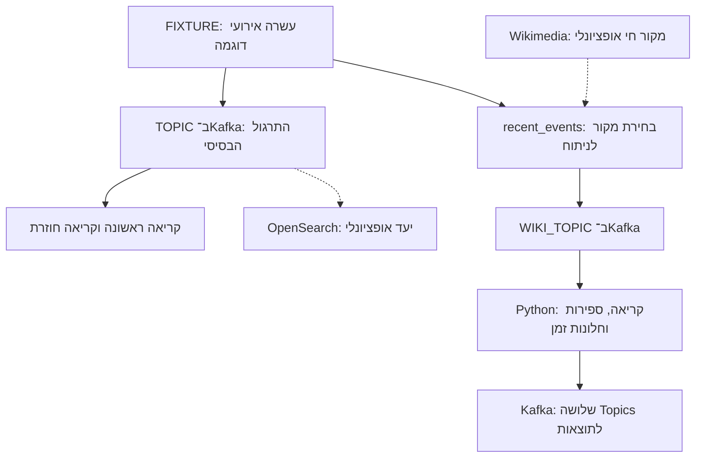
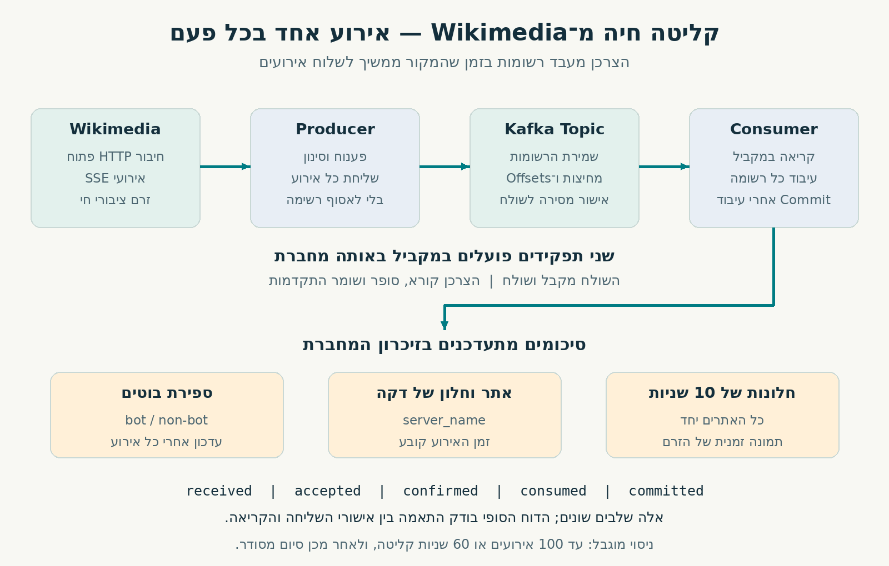

<!-- Hebrew prose uses explicit RTL/right alignment; examples remain LTR. -->

<div dir="rtl" lang="he" align="right">

<h1 dir="rtl" align="right">מה אנחנו עושים במחברת <span dir="ltr">Kafka</span>?</h1>

<p dir="rtl" align="right"><strong>מדריך מפורט למחברת <span dir="ltr">Kafka</span> עם <span dir="ltr">Python</span> — ד״ר פאול אברהמי</strong></p>

<p dir="rtl" align="right"><a href="../README.md">חזרה להוראות הפרויקט</a> · <a href="../Kafka_Python_Step_by_Step_HE.ipynb">פתיחת המחברת</a> · <a href="KAFKA_TROUBLESHOOTING_HE.md">פתרון תקלות חיבור</a></p>

<p dir="rtl" align="right">במחברת אנחנו בונים מעבדה שמדגימה את המסלול של אירוע: <strong>יצירת נתון, שליחתו ל־<span dir="ltr">Kafka</span>, קריאתו על ידי צרכן, עיבודו ופרסום התוצאות בחזרה ל־<span dir="ltr">Kafka</span>.</strong></p>

<p dir="rtl" align="right">הדוגמה שלנו עוסקת באירועים שמייצגים שינויים בדפי <span dir="ltr">Wikipedia</span>. באמצעותם אנחנו לומדים גם את המנגנונים של <span dir="ltr">Kafka</span> וגם שאלות מעשיות: איך קוראים את אותם נתונים בכמה יישומים, מה עושים אחרי תקלה, ואיך הופכים אירועים בודדים לסיכומים לפי אתר ולפי זמן.</p>

<p dir="rtl" align="right">המדריך עובר לפי השלבים במחברת ומסביר את הפלטים. הוא מתייחס ל־<a href="../Kafka_Python_Step_by_Step_HE.ipynb">מחברת שבפרויקט</a>, כולל שלב <span dir="ltr">17</span> החדש לקליטה ולעיבוד במקביל.</p>


<p dir="rtl" align="right"><strong>התצורה המרכזית המתוארת כאן היא:</strong></p>

</div>

<div dir="ltr" align="left">

```python
RUN_LIVE_KAFKA = True
RUN_LIVE_WIKIMEDIA = False
RUN_LIVE_OPENSEARCH = False
```

</div>

<div dir="rtl" lang="he" align="right">

<p dir="rtl" align="right">בתצורה הזאת <strong><span dir="ltr">Kafka</span> אמיתי פועל ב־<span dir="ltr">Docker</span>, ואנחנו שולחים אליו נתוני דוגמה שהמחברת יוצרת בעצמה</strong>. החיבור ל־<span dir="ltr">Wikimedia</span> ול־<span dir="ltr">OpenSearch</span> נשאר כבוי.</p>

<p dir="rtl" align="right">בקובץ המחברת שבמאגר, ברירת המחדל של שלושת המתגים היא <code dir="ltr">False</code>. כדי לבצע את מסלול <span dir="ltr">Kafka</span> החי, משנים את ההגדרות כפי שמוצג לעיל. כשהכול כבוי, תרגילי <span dir="ltr">Python</span> המקומיים עדיין פועלים, אך אין שליחה או קריאה מול <span dir="ltr">Kafka</span>.</p>

<hr>

<h2 dir="rtl" align="right"><span dir="ltr">1</span>. מה בדיוק פועל במחשב?</h2>

<p dir="rtl" align="right">כדאי להפריד בין הרכיבים, כי לכל אחד תפקיד אחר:</p>

<table dir="rtl">
<thead>
<tr>
<th dir="rtl" align="right">רכיב</th>
<th dir="rtl" align="right">התפקיד שלו במעבדה</th>
</tr>
</thead>
<tbody><tr>
<td dir="rtl" align="right"><strong><span dir="ltr">Cursor</span></strong></td>
<td dir="rtl" align="right">העורך שבו פותחים את המחברת ומפעילים את התאים.</td>
</tr>
<tr>
<td dir="rtl" align="right"><strong><span dir="ltr">Python Kernel</span></strong></td>
<td dir="rtl" align="right">תהליך <span dir="ltr">Python</span> שמריץ את הקוד ושומר את המשתנים בזיכרון.</td>
</tr>
<tr>
<td dir="rtl" align="right"><strong><span dir="ltr">uv</span></strong></td>
<td dir="rtl" align="right">מנהל את גרסת <span dir="ltr">Python</span> ואת החבילות של הפרויקט.</td>
</tr>
<tr>
<td dir="rtl" align="right"><strong><span dir="ltr">Docker</span></strong></td>
<td dir="rtl" align="right">מפעיל את המכולה שבה נמצא שרת <span dir="ltr">Kafka</span>.</td>
</tr>
<tr>
<td dir="rtl" align="right"><strong><span dir="ltr">Kafka Broker</span></strong></td>
<td dir="rtl" align="right">שרת <span dir="ltr">Kafka</span> שמקבל רשומות, שומר אותן ומאפשר לצרכנים לקרוא אותן.</td>
</tr>
<tr>
<td dir="rtl" align="right"><strong><span dir="ltr">confluent-kafka</span></strong></td>
<td dir="rtl" align="right">ספריית <span dir="ltr">Python</span> שבאמצעותה המחברת מתקשרת עם שרת <span dir="ltr">Kafka</span>.</td>
</tr>
</tbody></table>

<p dir="rtl" align="right">כלומר, <strong>ה־<span dir="ltr">Producer</span>, ה־<span dir="ltr">Consumer</span> וחישובי הסיכומים הם קוד <span dir="ltr">Python</span> במחברת. שרת <span dir="ltr">Kafka</span> הוא תהליך נפרד בתוך <span dir="ltr">Docker</span>.</strong></p>

<p dir="rtl" align="right">כשאנחנו אומרים “שלחנו הודעה ל־<span dir="ltr">Kafka</span>”, קוד <span dir="ltr">Python</span> פנה לשרת דרך <code dir="ltr">127.0.0.1:9092</code>. כשאנחנו אומרים “צרכנו הודעה”, קוד <span dir="ltr">Python</span> קיבל מהשרת רשומה שנשמרה בו.</p>

<h2 dir="rtl" align="right"><span dir="ltr">2</span>. התמונה הגדולה: שני מסלולי הדגימה במחברת</h2>

<p dir="rtl" align="right">בשלבים <span dir="ltr">1–16</span> יש שני מסלולי דגימה עיקריים. בשלב <span dir="ltr">17</span> נוסף מסלול <span dir="ltr">Streaming</span> נפרד. ההפרדה חשובה להבנת הקוד:</p>

</div>

<div dir="ltr" align="left">



</div>

<div dir="rtl" lang="he" align="right">

<p dir="rtl" align="right">הציור מתאר את המסלול שבו <span dir="ltr">Kafka</span> מופעל. הקווים המקווקווים הם הרחבות אופציונליות. השליחה ל־<span dir="ltr">Topics</span> מתבצעת באמצעות <span dir="ltr">Producer</span>, והקריאה מהם באמצעות <span dir="ltr">Consumer</span>.</p>

<p dir="rtl" align="right"><strong>המסלול הראשון — <code dir="ltr">TOPIC</code> — מלמד את פעולות <span dir="ltr">Kafka</span> הבסיסיות:</strong> שליחה, קריאה, שמירת התקדמות וקריאה חוזרת.</p>

<p dir="rtl" align="right"><strong>המסלול השני — <code dir="ltr">WIKI_TOPIC</code> — מלמד עיבוד נתונים:</strong> בוחרים מקור נתונים, מעבירים אותם דרך <span dir="ltr">Kafka</span>, קוראים אותם, מחשבים סיכומים ומפרסמים את הסיכומים.</p>

<p dir="rtl" align="right">אותם נתוני דוגמה משמשים את שני המסלולים כאשר <span dir="ltr">Wikimedia</span> כבוי. המסלול הראשון ממשיך להשתמש בנתונים הסינתטיים גם כאשר מפעילים את מקור <span dir="ltr">Wikimedia</span> במסלול השני.</p>

<hr>

<h2 dir="rtl" align="right"><span dir="ltr">3</span>. שלב <span dir="ltr">1</span>: מגדירים את הניסוי</h2>

<p dir="rtl" align="right">בתחילת המחברת מגדירים את הסביבה ואת שלושת המתגים:</p>

</div>

<div dir="ltr" align="left">

```python
RUN_LIVE_KAFKA = True
RUN_LIVE_WIKIMEDIA = False
RUN_LIVE_OPENSEARCH = False
```

</div>

<div dir="rtl" lang="he" align="right">

<p dir="rtl" align="right">לכל מתג משמעות עצמאית:</p>

<ul dir="rtl" align="right">
<li dir="rtl" align="right"><code dir="ltr">RUN_LIVE_KAFKA</code> מפעיל יצירת <span dir="ltr">Topics</span>, שליחה וקריאה מול שרת <span dir="ltr">Kafka</span>.</li>
<li dir="rtl" align="right"><code dir="ltr">RUN_LIVE_WIKIMEDIA</code> קובע אם מקור הנתונים לניתוח יהיה דגימה מהאינטרנט.</li>
<li dir="rtl" align="right"><code dir="ltr">RUN_LIVE_OPENSEARCH</code> מפעיל כתיבת מסמכים לשרת <span dir="ltr">OpenSearch</span> שהוכן בנפרד.</li>
</ul>

<p dir="rtl" align="right">לכן בהחלט אפשר לעבוד עם <strong><span dir="ltr">Kafka</span> אמיתי ונתונים סינתטיים</strong>. זה המסלול שבו מתחילים, כי אפשר לדעת מראש מה אמורה להיות התוצאה.</p>

<h3 dir="rtl" align="right">מהו <span dir="ltr">RUN_ID</span>?</h3>

<p dir="rtl" align="right">כאשר <span dir="ltr">Kafka</span> מופעל, המחברת יוצרת מזהה קצר לניסוי, למשל:</p>

</div>

<div dir="ltr" align="left">

```python
RUN_ID = "a1b2c3d4"
```

</div>

<div dir="rtl" lang="he" align="right">

<p dir="rtl" align="right">המזהה מצטרף לשמות ה־<span dir="ltr">Topics</span>:</p>

</div>

<div dir="ltr" align="left">

```text
python.demo.a1b2c3d4
python.wikimedia.recentchange.a1b2c3d4
```

</div>

<div dir="rtl" lang="he" align="right">

<p dir="rtl" align="right">כך הרצה חדשה של תא ההגדרות יוצרת שמות חדשים לניסוי, ומקטינה ערבוב עם נתוני הרצות קודמות.</p>

<p dir="rtl" align="right">יש לכך השלכה מעשית: <strong>הרצת כל המחברת מחדש והרצת תא <span dir="ltr">Consumer</span> בלבד הן פעולות שונות.</strong> הראשונה יוצרת ניסוי חדש; השנייה יכולה להמשיך לעבוד עם אותו <span dir="ltr">Topic</span> ועם ההתקדמות שכבר נשמרה.</p>

<p dir="rtl" align="right">תא האבחון הבא מדפיס את גרסת <span dir="ltr">Python</span>, נתיב ה־<span dir="ltr">Kernel</span> וגרסאות החבילות. מטרתו לוודא שהמחברת רצה בסביבה שהתכוונו אליה.</p>

<hr>

<h2 dir="rtl" align="right"><span dir="ltr">4</span>. שלב <span dir="ltr">2</span>: יוצרים עשרה אירועים לדוגמה</h2>

<p dir="rtl" align="right">המשתנה המרכזי הראשון הוא:</p>

</div>

<div dir="ltr" align="left">

```python
FIXTURE
```

</div>

<div dir="rtl" lang="he" align="right">

<p dir="rtl" align="right">זו רשימת <span dir="ltr">Python</span> שמכילה עשרה מילונים. כל מילון מתאר אירוע אחד.</p>

<p dir="rtl" align="right">לדוגמה, האירוע הראשון נראה כך:</p>

</div>

<div dir="ltr" align="left">

```json
{
  "meta": {
    "id": "synthetic-001",
    "dt": "2026-11-21T12:00:02+00:00"
  },
  "server_name": "en.wikipedia.org",
  "bot": true,
  "type": "edit",
  "title": "Synthetic page 1",
  "synthetic": true
}
```

</div>

<div dir="rtl" lang="he" align="right">

<p dir="rtl" align="right">המשמעות היא: לצורך התרגיל, אנחנו מדמיינים שבשעה <code dir="ltr">12:00:02 UTC</code> התרחשה עריכה באתר האנגלי, והיא מסומנת כפעולת <span dir="ltr">Bot</span>.</p>

<p dir="rtl" align="right">השדות החשובים הם:</p>

<ul dir="rtl" align="right">
<li dir="rtl" align="right"><strong><code dir="ltr">meta.id</code></strong> — מזהה האירוע.</li>
<li dir="rtl" align="right"><strong><code dir="ltr">meta.dt</code></strong> — הזמן שבו האירוע התרחש לפי הנתונים.</li>
<li dir="rtl" align="right"><strong><code dir="ltr">server_name</code></strong> — האתר שאליו האירוע שייך.</li>
<li dir="rtl" align="right"><strong><code dir="ltr">bot</code></strong> — האם האירוע מסומן כפעולת <span dir="ltr">Bot</span>.</li>
<li dir="rtl" align="right"><strong><code dir="ltr">synthetic</code></strong> — סימון מפורש שמדובר בנתון מומצא לתרגול.</li>
</ul>

<p dir="rtl" align="right">אלה עשרת האירועים. כל הזמנים בטבלה הם <strong><span dir="ltr">UTC</span></strong>:</p>

<table dir="rtl">
<thead>
<tr>
<th dir="rtl" align="right">אירוע</th>
<th dir="rtl" align="right">זמן</th>
<th dir="rtl" align="right">אתר</th>
<th dir="rtl" align="right">מסומן כ־<span dir="ltr">Bot</span>?</th>
</tr>
</thead>
<tbody><tr>
<td dir="rtl" align="right"><span dir="ltr">001</span></td>
<td dir="rtl" align="right"><span dir="ltr">12:00:02</span></td>
<td dir="rtl" align="right">אנגלית</td>
<td dir="rtl" align="right">כן</td>
</tr>
<tr>
<td dir="rtl" align="right"><span dir="ltr">002</span></td>
<td dir="rtl" align="right"><span dir="ltr">12:00:04</span></td>
<td dir="rtl" align="right">אנגלית</td>
<td dir="rtl" align="right">לא</td>
</tr>
<tr>
<td dir="rtl" align="right"><span dir="ltr">003</span></td>
<td dir="rtl" align="right"><span dir="ltr">12:00:08</span></td>
<td dir="rtl" align="right">עברית</td>
<td dir="rtl" align="right">כן</td>
</tr>
<tr>
<td dir="rtl" align="right"><span dir="ltr">004</span></td>
<td dir="rtl" align="right"><span dir="ltr">12:00:10</span></td>
<td dir="rtl" align="right">אנגלית</td>
<td dir="rtl" align="right">כן</td>
</tr>
<tr>
<td dir="rtl" align="right"><span dir="ltr">005</span></td>
<td dir="rtl" align="right"><span dir="ltr">12:00:12</span></td>
<td dir="rtl" align="right">עברית</td>
<td dir="rtl" align="right">לא</td>
</tr>
<tr>
<td dir="rtl" align="right"><span dir="ltr">006</span></td>
<td dir="rtl" align="right"><span dir="ltr">12:00:20</span></td>
<td dir="rtl" align="right">אנגלית</td>
<td dir="rtl" align="right">כן</td>
</tr>
<tr>
<td dir="rtl" align="right"><span dir="ltr">007</span></td>
<td dir="rtl" align="right"><span dir="ltr">12:00:25</span></td>
<td dir="rtl" align="right">גרמנית</td>
<td dir="rtl" align="right">לא</td>
</tr>
<tr>
<td dir="rtl" align="right"><span dir="ltr">008</span></td>
<td dir="rtl" align="right"><span dir="ltr">12:00:45</span></td>
<td dir="rtl" align="right">עברית</td>
<td dir="rtl" align="right">כן</td>
</tr>
<tr>
<td dir="rtl" align="right"><span dir="ltr">009</span></td>
<td dir="rtl" align="right"><span dir="ltr">12:01:01</span></td>
<td dir="rtl" align="right">אנגלית</td>
<td dir="rtl" align="right">כן</td>
</tr>
<tr>
<td dir="rtl" align="right"><span dir="ltr">010</span></td>
<td dir="rtl" align="right"><span dir="ltr">12:01:05</span></td>
<td dir="rtl" align="right">עברית</td>
<td dir="rtl" align="right">לא</td>
</tr>
</tbody></table>

<p dir="rtl" align="right">מכאן אפשר לחשב מראש:</p>

<ul dir="rtl" align="right">
<li dir="rtl" align="right">חמישה אירועים באתר האנגלי.</li>
<li dir="rtl" align="right">ארבעה באתר העברי.</li>
<li dir="rtl" align="right">אחד באתר הגרמני.</li>
<li dir="rtl" align="right">שישה מסומנים כ־<span dir="ltr">Bot</span> וארבעה אינם מסומנים כ־<span dir="ltr">Bot</span>.</li>
</ul>

<p dir="rtl" align="right"><strong>בחרנו נתונים קטנים וצפויים כדי שאפשר יהיה לבדוק אם הקוד מבצע את החישוב הנכון.</strong></p>

<hr>

<h2 dir="rtl" align="right"><span dir="ltr">5</span>. שלב <span dir="ltr">3</span>: מכינים את האירוע להעברה</h2>

<p dir="rtl" align="right">בתוך <span dir="ltr">Python</span> האירוע הוא מילון. להעברה לשרת אנחנו מייצגים אותו כ־<span dir="ltr">JSON</span> ומקודדים אותו לבתים ב־<span dir="ltr">UTF-8</span>:</p>

</div>

<div dir="ltr" align="left">

```python
value = json.dumps(event, ensure_ascii=False).encode("utf-8")
```

</div>

<div dir="rtl" lang="he" align="right">

<p dir="rtl" align="right">בצד הקורא מפענחים בחזרה:</p>

</div>

<div dir="ltr" align="left">

```python
event = json.loads(payload)
```

</div>

<div dir="rtl" lang="he" align="right">

<p dir="rtl" align="right">המחברת בודקת שהקידוד והפענוח מחזירים את אותו אירוע:</p>

</div>

<div dir="ltr" align="left">

```python
assert decoded == FIXTURE[0]
```

</div>

<div dir="rtl" lang="he" align="right">

<h3 dir="rtl" align="right">שלושה דברים שחשוב להבדיל ביניהם</h3>

<table dir="rtl">
<thead>
<tr>
<th dir="rtl" align="right">מושג</th>
<th dir="rtl" align="right">דוגמה</th>
<th dir="rtl" align="right">למה הוא משמש?</th>
</tr>
</thead>
<tbody><tr>
<td dir="rtl" align="right"><strong>מזהה האירוע</strong></td>
<td dir="rtl" align="right"><code dir="ltr">synthetic-001</code></td>
<td dir="rtl" align="right">זיהוי אותו אירוע עסקי גם אם נשלח שוב.</td>
</tr>
<tr>
<td dir="rtl" align="right"><strong>מפתח <span dir="ltr">Kafka</span> — <span dir="ltr">Key</span></strong></td>
<td dir="rtl" align="right"><code dir="ltr">en.wikipedia.org</code></td>
<td dir="rtl" align="right">קיבוץ אירועים קשורים לצורך חלוקה למחיצות.</td>
</tr>
<tr>
<td dir="rtl" align="right"><strong>מיקום ב־<span dir="ltr">Kafka</span></strong></td>
<td dir="rtl" align="right"><span dir="ltr">Topic, Partition, Offset</span></td>
<td dir="rtl" align="right">זיהוי המקום שבו רשומה מסוימת נשמרה ביומן.</td>
</tr>
</tbody></table>

<p dir="rtl" align="right">במחברת בחרנו בשם האתר בתור המפתח:</p>

</div>

<div dir="ltr" align="left">

```python
key = event["server_name"].encode("utf-8")
```

</div>

<div dir="rtl" lang="he" align="right">

<p dir="rtl" align="right">לכן לחמשת האירועים מהאתר האנגלי יש אותו מפתח, אבל לכל אחד מהם מזהה אירוע אחר.</p>

<h3 dir="rtl" align="right">ויש גם שני מושגים שונים של זמן</h3>

<p dir="rtl" align="right">החלונות שנחשב בהמשך משתמשים ב־<code dir="ltr">meta.dt</code>, הזמן שבתוכן האירוע.</p>

<p dir="rtl" align="right">בשליחות שבמחברת אנחנו בדרך כלל לא מעבירים <code dir="ltr">timestamp_fn</code>, ולכן זמן רשומת <span dir="ltr">Kafka</span> נקבע באמצעות ברירת המחדל של ה־<span dir="ltr">Producer</span>. <strong>הזמן הסינתטי שבתוך ה־<span dir="ltr">JSON</span> נשאר הנתון שעליו מבוסס הניתוח שלנו.</strong></p>

<p dir="rtl" align="right">כך אפשר לתרגל אירועים מזמנים קבועים, בלי לבלבל בין זמן האירוע בדוגמה לבין רגע השליחה בפועל.</p>

<hr>

<h2 dir="rtl" align="right"><span dir="ltr">6</span>. שלב <span dir="ltr">4</span>: יוצרים את המקומות שבהם הנתונים יישמרו</h2>

<p dir="rtl" align="right">בשלב הזה משתמשים ב־<code dir="ltr">AdminClient</code> כדי להכין את ה־<span dir="ltr">Topics</span>.</p>

<p dir="rtl" align="right"><strong><span dir="ltr">Topic</span> הוא יומן רשומות בעל שם.</strong> אנחנו בוחרים איזה סוג מידע נכתוב לכל <span dir="ltr">Topic</span>.</p>

<p dir="rtl" align="right">במחברת נוצרים חמישה <span dir="ltr">Topics</span>:</p>

<table dir="rtl">
<thead>
<tr>
<th dir="rtl" align="right">משתנה</th>
<th dir="rtl" align="right">תוכן</th>
</tr>
</thead>
<tbody><tr>
<td dir="rtl" align="right"><code dir="ltr">TOPIC</code></td>
<td dir="rtl" align="right">עשרת אירועי הדוגמה לתרגול <span dir="ltr">Kafka</span> הבסיסי.</td>
</tr>
<tr>
<td dir="rtl" align="right"><code dir="ltr">WIKI_TOPIC</code></td>
<td dir="rtl" align="right">האירועים שמהם נבצע את הניתוח.</td>
</tr>
<tr>
<td dir="rtl" align="right"><code dir="ltr">RESULT_TOPICS[&quot;bots&quot;]</code></td>
<td dir="rtl" align="right">סיכומי <span dir="ltr">Bot / non-bot</span>.</td>
</tr>
<tr>
<td dir="rtl" align="right"><code dir="ltr">RESULT_TOPICS[&quot;websites&quot;]</code></td>
<td dir="rtl" align="right">סיכומים לפי אתר וחלון של דקה.</td>
</tr>
<tr>
<td dir="rtl" align="right"><code dir="ltr">RESULT_TOPICS[&quot;timeseries&quot;]</code></td>
<td dir="rtl" align="right">סיכומים בחלונות של עשר שניות.</td>
</tr>
</tbody></table>

<p dir="rtl" align="right">לכל <span dir="ltr">Topic</span> אנחנו מגדירים:</p>

</div>

<div dir="ltr" align="left">

```python
num_partitions = 3
replication_factor = 1
```

</div>

<div dir="rtl" lang="he" align="right">

<p dir="rtl" align="right"><strong>שלוש מחיצות</strong> פירושן שהרשומות יכולות להתחלק לשלושה יומנים פנימיים של אותו <span dir="ltr">Topic</span>. <strong>עותק אחד</strong> פירושו שאין במעבדה עותק נוסף של המחיצה בשרת אחר. חלוקה למחיצות ושכפול הם מנגנונים שונים. <a href="https://kafka.apache.org/intro/">מקור: מבוא <span dir="ltr">Apache Kafka</span></a>.</p>

<p dir="rtl" align="right">הפונקציה <code dir="ltr">ensure_topics()</code> מבצעת את ההכנה והבדיקות: חיבור לשרת, בדיקת הכתובות שהשרת מפרסם, יצירת <span dir="ltr">Topics</span> חסרים והמתנה למוכנות המחיצות.</p>

<p dir="rtl" align="right">לצורך הבנת השיעור, התפקיד שלה הוא:</p>

<blockquote dir="rtl" align="right">
<p dir="rtl" align="right">לפני שאנחנו שולחים אירועים, לוודא שה־<span dir="ltr">Topic</span> שאליו נשלח קיים ומוכן לקבל אותם.</p>
</blockquote>

<hr>

<h2 dir="rtl" align="right"><span dir="ltr">7</span>. שלב <span dir="ltr">5</span>: שולחים אירועים באמצעות <span dir="ltr">Producer</span></h2>

<p dir="rtl" align="right">כעת מפעילים:</p>

</div>

<div dir="ltr" align="left">

```python
delivery_report = publish_json_rows(
    FIXTURE,
    TOPIC,
    key_fn=lambda event: event["server_name"],
    limit=MAX_MESSAGES,
)
```

</div>

<div dir="rtl" lang="he" align="right">

<p dir="rtl" align="right">כלומר: קח את אירועי הדוגמה, ושלח עד עשרה מהם ל־<code dir="ltr">TOPIC</code>, כאשר שם האתר הוא המפתח.</p>

<p dir="rtl" align="right">הביטוי:</p>

</div>

<div dir="ltr" align="left">

```python
lambda event: event["server_name"]
```

</div>

<div dir="rtl" lang="he" align="right">

<p dir="rtl" align="right">הוא פונקציה קטנה שאומרת: “מתוך האירוע שקיבלת, החזר את שם האתר”.</p>

<h3 dir="rtl" align="right">מה קורה בתוך פונקציית השליחה?</h3>

<p dir="rtl" align="right">לכל אירוע הפונקציה מכינה מפתח ו־<span dir="ltr">JSON</span>, ומפעילה <code dir="ltr">produce()</code>.</p>

<p dir="rtl" align="right">השליחה היא אסינכרונית: התוצאה הסופית מגיעה באמצעות פונקציית <span dir="ltr">Callback</span>. פעולות <code dir="ltr">poll()</code> ו־<code dir="ltr">flush()</code> מאפשרות ללקוח לטפל באישורי המסירה ובשגיאות. <a href="https://docs.confluent.io/platform/current/clients/confluent-kafka-python/html/index.html">מקור: <span dir="ltr">Confluent Python API</span></a>.</p>

<p dir="rtl" align="right">לכן אנחנו אוספים שני מספרים:</p>

</div>

<div dir="ltr" align="left">

```python
{
    "accepted": 10,
    "confirmed": 10
}
```

</div>

<div dir="rtl" lang="he" align="right">

<ul dir="rtl" align="right">
<li dir="rtl" align="right"><strong><code dir="ltr">accepted</code></strong> — כמה רשומות התקבלו לתור השליחה המקומי.</li>
<li dir="rtl" align="right"><strong><code dir="ltr">confirmed</code></strong> — כמה רשומות קיבלו אישור מסירה מוצלח.</li>
</ul>

<p dir="rtl" align="right">בנוסף, <code dir="ltr">records</code> מכילה פרטי מסירה, ובהם המחיצה וה־<span dir="ltr">Offset</span> האמיתיים שקיבלה כל רשומה.</p>

<p dir="rtl" align="right"><strong>האישור הזה אומר שהשליחה ל־<span dir="ltr">Kafka</span> הצליחה. הוא עדיין אינו אומר שצרכן כלשהו עיבד את האירוע.</strong> קריאת האירועים היא השלב הבא.</p>

<hr>

<h2 dir="rtl" align="right"><span dir="ltr">8</span>. שלב <span dir="ltr">6</span>: מבינים מפתחות ומחיצות</h2>

<p dir="rtl" align="right">כאן אנחנו בוחנים את חמשת האירועים מהאתר האנגלי.</p>

<p dir="rtl" align="right">לכולם יש:</p>

</div>

<div dir="ltr" align="left">

```text
Key = en.wikipedia.org
```

</div>

<div dir="rtl" lang="he" align="right">

<p dir="rtl" align="right">המחברת בודקת תחילה שהמפתחות אכן זהים. במסלול החי היא בודקת גם את דוח המסירה, כדי לראות לאילו מחיצות האירועים הגיעו.</p>

<p dir="rtl" align="right">כאשר הגדרות החלוקה ומספר המחיצות נשארים קבועים, אותו מפתח משמש לשמירת הזיקה למחיצה. הסדר ש־<span dir="ltr">Kafka</span> מספק הוא סדר בתוך מחיצה; אין כאן סדר כולל אחד בין כל המחיצות. <a href="https://kafka.apache.org/intro/">מקור: מבוא <span dir="ltr">Apache Kafka</span></a>.</p>

<p dir="rtl" align="right">למה זה שימושי?</p>

<p dir="rtl" align="right">אם נרצה לעבד ברצף את האירועים של אותו לקוח, אפשר לבחור <code dir="ltr">customer_id</code> כמפתח. במקרה שלנו אנחנו מקבצים לפי אתר.</p>

<p dir="rtl" align="right">עם זאת, <strong>מפתחות שונים יכולים להגיע לאותה מחיצה</strong>. שלושה אתרים ושלוש מחיצות אינם מבטיחים “מחיצה אחת לכל אתר”.</p>

<p dir="rtl" align="right">בתרגיל שבמחברת אנחנו גם חושבים על חלוקת עבודה: בקבוצת צרכנים רגילה, <span dir="ltr">Topic</span> עם שלוש מחיצות יכול להקצות מחיצות לכל היותר לשלושה צרכנים באותה קבוצה. צרכן רביעי עשוי להישאר ללא מחיצה.</p>

<hr>

<h2 dir="rtl" align="right"><span dir="ltr">9</span>. שלב <span dir="ltr">7</span>: קוראים את האירועים באמצעות <span dir="ltr">Consumer</span></h2>

<p dir="rtl" align="right">כעת המחברת קוראת מה־<span dir="ltr">Topic</span>:</p>

</div>

<div dir="ltr" align="left">

```python
receipts = consume_events(
    TOPIC,
    "python-students-a",
    remember,
    MAX_MESSAGES,
    READ_DEADLINE_SECONDS,
)
```

</div>

<div dir="rtl" lang="he" align="right">

<p dir="rtl" align="right">הפרמטרים אומרים:</p>

<ul dir="rtl" align="right">
<li dir="rtl" align="right">קרא מ־<code dir="ltr">TOPIC</code>.</li>
<li dir="rtl" align="right">השתמש בקבוצת הצרכנים <code dir="ltr">python-students-a</code>.</li>
<li dir="rtl" align="right">עבור כל אירוע, הפעל את <code dir="ltr">remember</code>.</li>
<li dir="rtl" align="right">קרא עד עשר רשומות, במסגרת מגבלת לולאת הקריאה.</li>
</ul>

<p dir="rtl" align="right">הפונקציה <code dir="ltr">remember()</code> מוסיפה את האירוע לרשימה:</p>

</div>

<div dir="ltr" align="left">

```python
observed_events
```

</div>

<div dir="rtl" lang="he" align="right">

<h3 dir="rtl" align="right">מה עושה הצרכן לכל רשומה?</h3>

<p dir="rtl" align="right">הסדר בקוד הוא:</p>

<ol dir="rtl" align="right">
<li dir="rtl" align="right">קורא רשומה מ־<span dir="ltr">Kafka</span>.</li>
<li dir="rtl" align="right">מפענח את ה־<span dir="ltr">JSON</span>.</li>
<li dir="rtl" align="right">מפעיל את פעולת העיבוד — כאן <code dir="ltr">remember</code>.</li>
<li dir="rtl" align="right">מבצע <span dir="ltr">Commit</span>.</li>
<li dir="rtl" align="right">מוסיף אישור לרשימת <code dir="ltr">receipts</code>.</li>
</ol>

<p dir="rtl" align="right">העיקרון הוא <strong>לשמור התקדמות אחרי הצלחת העיבוד</strong>.</p>

<h3 dir="rtl" align="right">מהו <span dir="ltr">Commit</span>?</h3>

<p dir="rtl" align="right"><span dir="ltr">Commit</span> שומר את מיקום ההמשך של קבוצת הצרכנים במחיצה. בשימוש שבמחברת, <span dir="ltr">Commit</span> על הודעה ב־<span dir="ltr">Offset</span> מסוים שומר את ה־<span dir="ltr">Offset</span> הבא. לדוגמה, אחרי טיפול מוצלח ברשומה ב־<span dir="ltr">Offset</span> <code dir="ltr">7</code>, מיקום ההמשך הוא <code dir="ltr">8</code>. <a href="https://docs.confluent.io/platform/current/clients/confluent-kafka-python/html/index.html#confluent_kafka.Consumer.commit">מקור: <span dir="ltr">Confluent Python API</span> — <span dir="ltr">commit</span></a>.</p>

<p dir="rtl" align="right">זה אינו מונה כולל של כל ה־<span dir="ltr">Topic</span>: לכל מחיצה מיקום משלה.</p>

<p dir="rtl" align="right">כאשר מופיע:</p>

</div>

<div dir="ltr" align="left">

```text
LIVE processed and committed: 10
```

</div>

<div dir="rtl" lang="he" align="right">

<p dir="rtl" align="right">המשמעות היא שעשר רשומות נקראו, פעולת העיבוד שלהן הסתיימה, ונשמרה עבורן התקדמות.</p>

<p dir="rtl" align="right">בשלב הזה פעולת העיבוד היא שמירה ברשימת <span dir="ltr">Python</span>. בהמשך משתמשים באותה פונקציית צריכה עם פעולת עיבוד אחרת.</p>

<hr>

<h2 dir="rtl" align="right"><span dir="ltr">10</span>. שלב <span dir="ltr">8</span>: קוראים שוב את אותם אירועים</h2>

<p dir="rtl" align="right">כאן לומדים למה קבוצות צרכנים חשובות.</p>

<p dir="rtl" align="right">נניח שקבוצה <span dir="ltr">A</span> קראה את כל עשרת האירועים ושמרה התקדמות. אם נפעיל שוב את אותה קבוצה על אותו <span dir="ltr">Topic</span>, היא יכולה להמשיך מהמיקום ששמרה.</p>

<p dir="rtl" align="right">לעומת זאת, המחברת יוצרת קבוצה חדשה:</p>

</div>

<div dir="ltr" align="left">

```text
python-replay-<random-id>
```

</div>

<div dir="rtl" lang="he" align="right">

<p dir="rtl" align="right">לקבוצה החדשה אין התקדמות קודמת באותו <span dir="ltr">Topic</span>, ולכן היא יכולה לקרוא את ההיסטוריה הזמינה לפי מדיניות ההתחלה שלה.</p>

<h3 dir="rtl" align="right">מה אומר <span dir="ltr">earliest</span>?</h3>

<p dir="rtl" align="right">ההגדרה:</p>

</div>

<div dir="ltr" align="left">

```python
"auto.offset.reset": "earliest"
```

</div>

<div dir="rtl" lang="he" align="right">

<p dir="rtl" align="right">קובעת להתחיל מהמיקום המוקדם הזמין כאשר אין מיקום שמור תקף. היא אינה מאפסת בכל הפעלה קבוצה שכבר שמרה התקדמות. <a href="https://kafka.apache.org/44/configuration/consumer-configs/">מקור: הגדרות <span dir="ltr">Consumer</span> של <span dir="ltr">Apache Kafka</span></a>.</p>

<p dir="rtl" align="right">זו הסיבה לשני פלטים שונים אפשריים:</p>

<ul dir="rtl" align="right">
<li dir="rtl" align="right">אותה קבוצה שכבר סיימה — עשויה לקרוא אפס אירועים נוספים.</li>
<li dir="rtl" align="right">קבוצה חדשה — יכולה לקרוא שוב את עשרת האירועים.</li>
</ul>

<p dir="rtl" align="right">קריאת אירוע אינה מוחקת אותו. זמינותו לקריאה חוזרת תלויה במדיניות השמירה ובמה שעדיין קיים ב־<span dir="ltr">Topic</span>. <a href="https://kafka.apache.org/intro/">מקור: מבוא <span dir="ltr">Apache Kafka</span></a>.</p>

<p dir="rtl" align="right">היכולת הזאת מאפשרת לכמה יישומים להשתמש באותם אירועים, כאשר לכל אחד התקדמות משלו.</p>

<hr>

<h2 dir="rtl" align="right"><span dir="ltr">11</span>. שלב <span dir="ltr">9</span>: מדמים תקלה בין כתיבה לשמירת התקדמות</h2>

<p dir="rtl" align="right">זה אחד החלקים החשובים במחברת להבנת מערכות נתונים.</p>

<p dir="rtl" align="right"><strong>הניסוי הזה מתבצע כולו בזיכרון <span dir="ltr">Python</span>, גם כשה־<span dir="ltr">Kafka</span> החי מופעל.</strong></p>

<p dir="rtl" align="right">אנחנו מגדירים:</p>

</div>

<div dir="ltr" align="left">

```python
documents = {}
checkpoint = {"next_offset": 0}
```

</div>

<div dir="rtl" lang="he" align="right">

<p dir="rtl" align="right">המילון <code dir="ltr">documents</code> מדמה מאגר מסמכים. <code dir="ltr">checkpoint</code> מדמה את מיקום ההמשך.</p>

<p dir="rtl" align="right">לכל אירוע עושים שתי פעולות:</p>

</div>

<div dir="ltr" align="left">

```python
documents[document_id] = event
checkpoint["next_offset"] = offset + 1
```

</div>

<div dir="rtl" lang="he" align="right">

<p dir="rtl" align="right">כעת אנחנו יוצרים במכוון תקלה <strong>אחרי כתיבת האירוע הרביעי, ולפני עדכון ההתקדמות שלו</strong>.</p>

<p dir="rtl" align="right">מכיוון שהספירה מתחילה באפס, האירוע הרביעי נמצא ב־<span dir="ltr">Offset</span> <code dir="ltr">3</code>.</p>

<p dir="rtl" align="right">בנקודת התקלה:</p>

<ul dir="rtl" align="right">
<li dir="rtl" align="right">ארבעה מסמכים כבר נכתבו.</li>
<li dir="rtl" align="right">מיקום ההמשך עדיין מצביע על <code dir="ltr">3</code>.</li>
<li dir="rtl" align="right">כלומר, המערכת עדיין אינה יודעת שהאירוע הרביעי הושלם.</li>
</ul>

<p dir="rtl" align="right">כשקוראים שוב ל־<code dir="ltr">process_offline()</code>, האירוע הרביעי מעובד שוב.</p>

<h3 dir="rtl" align="right">אז למה נשארים רק עשרה מסמכים?</h3>

<p dir="rtl" align="right">כי המפתח במילון הוא מזהה האירוע:</p>

</div>

<div dir="ltr" align="left">

```python
documents["synthetic-004"] = event
```

</div>

<div dir="rtl" lang="he" align="right">

<p dir="rtl" align="right">הכתיבה השנייה משתמשת באותו מזהה, ולכן מעדכנת את אותה רשומה במילון.</p>

<p dir="rtl" align="right">התוצאה היא:</p>

</div>

<div dir="ltr" align="left">

```text
10 unique documents
11 write attempts
Event 004 attempts: 2
```

</div>

<div dir="rtl" lang="he" align="right">

<p dir="rtl" align="right"><strong>האירוע עובד פעמיים, אבל התוצאה הסופית כוללת מסמך אחד עבורו.</strong></p>

<p dir="rtl" align="right">זה מלמד למה מזהה יציב חשוב כאשר פעולה עלולה להתבצע שוב. הפעולה הזאת מתאימה לעדכון מסמך לפי מזהה; בפעולות כמו חיוב כספי או שליחת הודעה צריך לתכנן מניעת כפילויות שמתאימה לפעולה.</p>

<p dir="rtl" align="right">המילה <code dir="ltr">restart</code> בפלט של הניסוי פירושה קריאה חוזרת לפונקציה. אין צורך לאתחל את ה־<span dir="ltr">Kernel</span> באמצע — אתחול שלו ימחק את המילונים שבהם אנחנו משתמשים בניסוי.</p>

<hr>

<h2 dir="rtl" align="right"><span dir="ltr">12</span>. שלב <span dir="ltr">10</span>: הרחבה אופציונלית ל־<span dir="ltr">OpenSearch</span></h2>

<p dir="rtl" align="right">כאן מחליפים את פעולת העיבוד של הצרכן.</p>

<p dir="rtl" align="right">בשלב <span dir="ltr">7</span> הצרכן הפעיל:</p>

</div>

<div dir="ltr" align="left">

```python
remember(event)
```

</div>

<div dir="rtl" lang="he" align="right">

<p dir="rtl" align="right">בשלב <span dir="ltr">OpenSearch</span> הוא מפעיל:</p>

</div>

<div dir="ltr" align="left">

```python
index_event(client, event)
```

</div>

<div dir="rtl" lang="he" align="right">

<p dir="rtl" align="right">כלומר, במקום לשמור ברשימת <span dir="ltr">Python</span>, הוא כותב מסמך למנוע החיפוש.</p>

<p dir="rtl" align="right">מזהה המסמך הוא שוב:</p>

</div>

<div dir="ltr" align="left">

```python
event["meta"]["id"]
```

</div>

<div dir="rtl" lang="he" align="right">

<p dir="rtl" align="right">ב־<span dir="ltr">OpenSearch</span>, פעולת <span dir="ltr">Index</span> עם מזהה קיים מעדכנת את המסמך הקיים. זו ההתנהגות שהדגמנו קודם באמצעות מילון. <a href="https://docs.opensearch.org/latest/api-reference/document-apis/index-document/">מקור: <span dir="ltr">OpenSearch Index Document API</span></a>.</p>

<p dir="rtl" align="right">ה־<span dir="ltr">Commit</span> מתבצע לאחר שהכתיבה אושרה.</p>

<p dir="rtl" align="right">אם ההגדרה נשארה:</p>

</div>

<div dir="ltr" align="left">

```python
RUN_LIVE_OPENSEARCH = False
```

</div>

<div dir="rtl" lang="he" align="right">

<p dir="rtl" align="right">החיבור הזה דולג.</p>

<p dir="rtl" align="right">עוד פרט חשוב: <strong>הקוד שסיפקנו ל־<span dir="ltr">OpenSearch</span> קורא מ־<code dir="ltr">TOPIC</code>, מסלול הדוגמה הראשון.</strong> הוא אינו קורא אוטומטית מה־<span dir="ltr">Topic</span> של ניתוח <span dir="ltr">Wikimedia</span>.</p>

<hr>

<h2 dir="rtl" align="right"><span dir="ltr">13</span>. שלבים <span dir="ltr">11–12</span>: בוחרים מקור נתונים לניתוח</h2>

<p dir="rtl" align="right">כאן מתחיל המסלול השני של המחברת.</p>

<h3 dir="rtl" align="right">שלב <span dir="ltr">11</span> — הכנה לקליטה מ־<span dir="ltr">Wikimedia</span></h3>

<p dir="rtl" align="right"><span dir="ltr">Wikimedia</span> מציעה שירות אירועים דרך <span dir="ltr">HTTP</span> בפרוטוקול <span dir="ltr">SSE</span> — <span dir="ltr">Server-Sent Events</span>. <a href="https://wikitech.wikimedia.org/wiki/Event_Platform/EventStreams">מקור: <span dir="ltr">Wikimedia EventStreams</span></a>.</p>

<p dir="rtl" align="right">בשלב זה משתמשים בשלוש פונקציות; מנגנון החיבור המלא נמצא ב־<code dir="ltr">scripts/wikimedia_stream.py</code>:</p>

<ul dir="rtl" align="right">
<li dir="rtl" align="right"><code dir="ltr">parse_sse_blocks()</code> — מיובאת מקובץ העזר ומפרקת את הטקסט שמגיע מהשירות למסגרות אירוע, כולל סמן המשך והמלצה להשהיה.</li>
<li dir="rtl" align="right"><code dir="ltr">iter_wikimedia_events()</code> — פותחת חיבור חי ומוסרת אירוע תקין אחד בכל פעם.</li>
<li dir="rtl" align="right"><code dir="ltr">read_wikimedia_events()</code> — עוטפת את האיטרטור ואוספת ממנו רשימה קטנה לשיעור הדגימה.</li>
</ul>

<p dir="rtl" align="right">הפענוח מתייחס, בין היתר, לשורה ריקה שמסיימת אירוע, לשורות <code dir="ltr">data:</code> ולשורות הערה שמתחילות בנקודתיים. כללי המבנה האלה מגיעים מפרוטוקול <span dir="ltr">SSE</span>. <a href="https://html.spec.whatwg.org/multipage/server-sent-events.html">מקור: תקן <span dir="ltr">HTML</span> — <span dir="ltr">Server-Sent Events</span></a>.</p>

<p dir="rtl" align="right">אנחנו בודקים את המפענח תחילה באמצעות טקסט שנוצר מקומית. כך אפשר ללמוד ולבדוק את הפענוח בלי להיות תלויים בחיבור לאינטרנט.</p>

<p dir="rtl" align="right"><strong>תא שמכיל <code dir="ltr">def read_wikimedia_events(...)</code> רק מגדיר את הפונקציה. החיבור מתרחש כשקוראים לה.</strong></p>

<h3 dir="rtl" align="right">שלב <span dir="ltr">12</span> — בחירת המקור</h3>

<p dir="rtl" align="right">הבחירה נעשית כאן:</p>

</div>

<div dir="ltr" align="left">

```python
if RUN_LIVE_WIKIMEDIA:
    recent_events = read_wikimedia_events(limit=MAX_MESSAGES)
else:
    recent_events = copy.deepcopy(FIXTURE)
```

</div>

<div dir="rtl" lang="he" align="right">

<p dir="rtl" align="right">אם <span dir="ltr">Wikimedia</span> כבוי, <code dir="ltr">recent_events</code> מקבל עותק של עשרת אירועי הדוגמה.</p>

<p dir="rtl" align="right">אם הוא מופעל, המשתנה מקבל דגימה מהשירות החי. מספיק לקבוע <code dir="ltr">RUN_LIVE_WIKIMEDIA = True</code> כדי להחליף את מקור הדגימה. לחיבור גם לשרת המקומי צריך בנוסף <code dir="ltr">RUN_LIVE_KAFKA = True</code>. הדוגמה מוגבלת לעשרה אירועים; סיום הקליטה בשלב הזה מכוון.</p>

<h3 dir="rtl" align="right">ואז מעבירים את הדגימה דרך <span dir="ltr">Kafka</span></h3>

<p dir="rtl" align="right">כאשר <span dir="ltr">Kafka</span> מופעל:</p>

<ol dir="rtl" align="right">
<li dir="rtl" align="right">שולחים את <code dir="ltr">recent_events</code> ל־<code dir="ltr">WIKI_TOPIC</code>.</li>
<li dir="rtl" align="right">יוצרים קבוצת צרכנים חדשה לניתוח.</li>
<li dir="rtl" align="right">קוראים מה־<span dir="ltr">Topic</span>.</li>
<li dir="rtl" align="right">שומרים את האירועים שנקראו ברשימה:</li>
</ol>

</div>

<div dir="ltr" align="left">

```python
ANALYSIS_EVENTS
```

</div>

<div dir="rtl" lang="he" align="right">

<p dir="rtl" align="right"><strong>זוהי הרשימה שממנה מחושבים הסיכומים בהמשך.</strong></p>

<p dir="rtl" align="right">לכן במסלול החי הניתוח משתמש במה שנקרא מ־<span dir="ltr">Kafka</span>. אם הצרכן קרא רק חלק מהדגימה, החישובים יתבססו על החלק שנקרא.</p>

<p dir="rtl" align="right">כאשר <span dir="ltr">Kafka</span> כבוי, הרשימה הזאת מקבלת ישירות עותק מקומי של <code dir="ltr">recent_events</code>.</p>

<hr>

<h2 dir="rtl" align="right"><span dir="ltr">14</span>. שלב <span dir="ltr">13</span>: סופרים אירועים לפי סימון <span dir="ltr">Bot</span></h2>

<p dir="rtl" align="right">כעת מתחיל העיבוד האנליטי.</p>

<p dir="rtl" align="right">הפונקציה:</p>

</div>

<div dir="ltr" align="left">

```python
classify_bot(event)
```

</div>

<div dir="rtl" lang="he" align="right">

<p dir="rtl" align="right">בודקת את השדה <code dir="ltr">bot</code> ומחזירה:</p>

</div>

<div dir="ltr" align="left">

```text
bot
non-bot
invalid
```

</div>

<div dir="rtl" lang="he" align="right">

<p dir="rtl" align="right">הסיווג מבוסס על ערך שכבר קיים באירוע. אין כאן מודל שמנסה לזהות התנהגות של <span dir="ltr">Bot</span>.</p>

<p dir="rtl" align="right">הספירה נעשית באמצעות:</p>

</div>

<div dir="ltr" align="left">

```python
bot_counts = Counter(
    classify_bot(event)
    for event in ANALYSIS_EVENTS
)
```

</div>

<div dir="rtl" lang="he" align="right">

<p dir="rtl" align="right">אם כל עשרת האירועים הסינתטיים נקראו, התוצאה היא:</p>

</div>

<div dir="ltr" align="left">

```python
{
    "bot": 6,
    "non-bot": 4
}
```

</div>

<div dir="rtl" lang="he" align="right">

<p dir="rtl" align="right">לאחר מכן בונים שתי שורות סיכום:</p>

</div>

<div dir="ltr" align="left">

```python
bot_rows = [
    {"category": "bot", "count": 6},
    {"category": "non-bot", "count": 4},
]
```

</div>

<div dir="rtl" lang="he" align="right">

<p dir="rtl" align="right">ההבדל בין שני המספרים חשוב:</p>

<ul dir="rtl" align="right">
<li dir="rtl" align="right"><code dir="ltr">6</code> הוא מספר האירועים המסומנים כ־<span dir="ltr">Bot</span>.</li>
<li dir="rtl" align="right"><code dir="ltr">2</code> הוא מספר שורות הסיכום ב־<code dir="ltr">bot_rows</code>.</li>
</ul>

<hr>

<h2 dir="rtl" align="right"><span dir="ltr">15</span>. שלב <span dir="ltr">14</span>: סופרים אירועים בחלונות זמן</h2>

<p dir="rtl" align="right">ספירה כוללת עונה על השאלה “כמה אירועים היו?”. חלונות זמן מאפשרים לשאול גם “מתי הם התרחשו?”.</p>

<p dir="rtl" align="right">במחברת מבצעים שני חישובים.</p>

<h3 dir="rtl" align="right">א. כמה אירועים היו בכל אתר, בכל דקה?</h3>

</div>

<div dir="ltr" align="left">

```python
site_rows = aggregate_windows(
    ANALYSIS_EVENTS,
    60,
    lambda event: event["server_name"],
)
```

</div>

<div dir="rtl" lang="he" align="right">

<p dir="rtl" align="right">אנחנו מקבצים לפי שילוב של:</p>

</div>

<div dir="ltr" align="left">

```text
Website + window start
```

</div>

<div dir="rtl" lang="he" align="right">

<p dir="rtl" align="right">כלומר, שם האתר ותחילת חלון הדקה.</p>

<p dir="rtl" align="right">עבור עשרת אירועי הדוגמה המלאים מתקבלות חמש שורות:</p>

<table dir="rtl">
<thead>
<tr>
<th dir="rtl" align="right">אתר</th>
<th dir="rtl" align="right">תחילת חלון ב־<span dir="ltr">UTC</span></th>
<th align="right" dir="rtl">מספר אירועים</th>
</tr>
</thead>
<tbody><tr>
<td dir="rtl" align="right">גרמנית</td>
<td dir="rtl" align="right"><span dir="ltr">12:00:00</span></td>
<td align="right" dir="rtl"><span dir="ltr">1</span></td>
</tr>
<tr>
<td dir="rtl" align="right">אנגלית</td>
<td dir="rtl" align="right"><span dir="ltr">12:00:00</span></td>
<td align="right" dir="rtl"><span dir="ltr">4</span></td>
</tr>
<tr>
<td dir="rtl" align="right">אנגלית</td>
<td dir="rtl" align="right"><span dir="ltr">12:01:00</span></td>
<td align="right" dir="rtl"><span dir="ltr">1</span></td>
</tr>
<tr>
<td dir="rtl" align="right">עברית</td>
<td dir="rtl" align="right"><span dir="ltr">12:00:00</span></td>
<td align="right" dir="rtl"><span dir="ltr">3</span></td>
</tr>
<tr>
<td dir="rtl" align="right">עברית</td>
<td dir="rtl" align="right"><span dir="ltr">12:01:00</span></td>
<td align="right" dir="rtl"><span dir="ltr">1</span></td>
</tr>
</tbody></table>

<p dir="rtl" align="right">סכום הספירות הוא עדיין עשרה.</p>

<h3 dir="rtl" align="right">ב. כמה אירועים מכל האתרים היו בכל עשר שניות?</h3>

</div>

<div dir="ltr" align="left">

```python
time_rows = aggregate_windows(
    ANALYSIS_EVENTS,
    10,
    lambda event: "all",
)
```

</div>

<div dir="rtl" lang="he" align="right">

<p dir="rtl" align="right">כאן המפתח הוא תמיד <code dir="ltr">&quot;all&quot;</code>, ולכן אנחנו מאחדים את כל האתרים ומקבצים רק לפי חלון הזמן.</p>

<table dir="rtl">
<thead>
<tr>
<th dir="rtl" align="right">תחילת חלון ב־<span dir="ltr">UTC</span></th>
<th dir="rtl" align="right">סוף החלון, שאינו נכלל בו</th>
<th align="right" dir="rtl">מספר אירועים</th>
</tr>
</thead>
<tbody><tr>
<td dir="rtl" align="right"><span dir="ltr">12:00:00</span></td>
<td dir="rtl" align="right"><span dir="ltr">12:00:10</span></td>
<td align="right" dir="rtl"><span dir="ltr">3</span></td>
</tr>
<tr>
<td dir="rtl" align="right"><span dir="ltr">12:00:10</span></td>
<td dir="rtl" align="right"><span dir="ltr">12:00:20</span></td>
<td align="right" dir="rtl"><span dir="ltr">2</span></td>
</tr>
<tr>
<td dir="rtl" align="right"><span dir="ltr">12:00:20</span></td>
<td dir="rtl" align="right"><span dir="ltr">12:00:30</span></td>
<td align="right" dir="rtl"><span dir="ltr">2</span></td>
</tr>
<tr>
<td dir="rtl" align="right"><span dir="ltr">12:00:40</span></td>
<td dir="rtl" align="right"><span dir="ltr">12:00:50</span></td>
<td align="right" dir="rtl"><span dir="ltr">1</span></td>
</tr>
<tr>
<td dir="rtl" align="right"><span dir="ltr">12:01:00</span></td>
<td dir="rtl" align="right"><span dir="ltr">12:01:10</span></td>
<td align="right" dir="rtl"><span dir="ltr">2</span></td>
</tr>
</tbody></table>

<p dir="rtl" align="right">לכן מתקבל:</p>

</div>

<div dir="ltr" align="left">

```python
[3, 2, 2, 1, 2]
```

</div>

<div dir="rtl" lang="he" align="right">

<p dir="rtl" align="right">החלון הראשון כולל את האירועים בשניות <code dir="ltr">02</code>, <code dir="ltr">04</code> ו־<code dir="ltr">08</code>.</p>

<p dir="rtl" align="right">האירוע בשנייה <code dir="ltr">10</code> שייך לחלון הבא. הגבול התחתון נכלל בחלון; הגבול העליון אינו נכלל בו.</p>

<h3 dir="rtl" align="right">איך הקוד מוצא את תחילת החלון?</h3>

<p dir="rtl" align="right">הוא מעגל את זמן האירוע כלפי מטה לכפולה של רוחב החלון. בכתיב הסברי:</p>

</div>

<div dir="ltr" align="left">

```python
start = (event_time_ms // window_width_ms) * window_width_ms
```

</div>

<div dir="rtl" lang="he" align="right">

<p dir="rtl" align="right">לדוגמה, בחלון של עשר שניות, זמן <code dir="ltr">12:00:12</code> שייך לחלון שמתחיל ב־<code dir="ltr">12:00:10</code>.</p>

<p dir="rtl" align="right">חלונות שאין בהם אירועים אינם מופיעים ברשימת התוצאות. כדי להציג אותם עם אפס נדרשת השלמה נוספת.</p>

<p dir="rtl" align="right"><strong>החישובים האלה מתבצעים ב־<span dir="ltr">Python</span> על הרשימה שנקראה. המחברת מחשבת תמונת מצב של דגימה מוגבלת.</strong> זו אינה הפעלה של מנוע <span dir="ltr">Kafka Streams</span> או של שירות עיבוד רציף.</p>

<hr>

<h2 dir="rtl" align="right"><span dir="ltr">16</span>. שלב <span dir="ltr">15</span>: מה קורה לאירוע שמגיע מאוחר?</h2>

<p dir="rtl" align="right">כאן אנחנו בודקים את ההבדל בין <strong>זמן האירוע</strong> לבין <strong>סדר הגעתו</strong>.</p>

<p dir="rtl" align="right">אנחנו לוקחים את אירועי הדוגמה, ובסוף הרשימה מוסיפים אירוע שזמנו:</p>

</div>

<div dir="ltr" align="left">

```text
12:00:03
```

</div>

<div dir="rtl" lang="he" align="right">

<p dir="rtl" align="right">כלומר, הוא נוסף אחרי שכבר ראינו אירועים מ־<code dir="ltr">12:01:05</code>, אבל לפי הזמן שלו הוא שייך לחלון הראשון.</p>

<p dir="rtl" align="right">לפני הוספתו היו בחלון הראשון שלושה אירועים. לאחר חישוב מחדש מתקבלים ארבעה:</p>

</div>

<div dir="ltr" align="left">

```text
Recomputed first window count: 4
```

</div>

<div dir="rtl" lang="he" align="right">

<p dir="rtl" align="right">למה?</p>

<p dir="rtl" align="right">כי פונקציית הסיכום עוברת על כל הרשימה ומשייכת כל אירוע לפי <code dir="ltr">meta.dt</code>, בלי קשר למיקומו ברשימה.</p>

<p dir="rtl" align="right"><strong>האירוע המאוחר הזה שייך לניסוי נפרד:</strong> הוא אינו נוסף ל־<code dir="ltr">ANALYSIS_EVENTS</code>, אינו נשלח ל־<span dir="ltr">Kafka</span>, ואינו משנה את שלושת הסיכומים שנפרסם בסוף.</p>

<p dir="rtl" align="right">המטרה הלימודית היא להבין שבמערכת רציפה צריך להחליט מה לעשות עם אירוע שמגיע אחרי שכבר פרסמנו סיכום לחלון שלו: לעדכן את הסיכום, לאפשר איחור מוגבל, או לטפל בו במסלול נפרד.</p>

<p dir="rtl" align="right">באותו אזור במחברת יש גם תרגיל נוסף: מסננים רק אירועי <span dir="ltr">Bot</span> מתוך <code dir="ltr">FIXTURE</code>, ואז סופרים אותם לפי אתר ודקה.</p>

<hr>

<h2 dir="rtl" align="right"><span dir="ltr">17</span>. שלב <span dir="ltr">16</span>: מפרסמים את הסיכומים בחזרה ל־<span dir="ltr">Kafka</span></h2>

<p dir="rtl" align="right">עכשיו יש לנו שלוש רשימות תוצאה:</p>

</div>

<div dir="ltr" align="left">

```python
bot_rows
site_rows
time_rows
```

</div>

<div dir="rtl" lang="he" align="right">

<p dir="rtl" align="right">המחברת שולחת כל רשימה ל־<span dir="ltr">Topic</span> המתאים.</p>

<p dir="rtl" align="right">עבור הדגימה הסינתטית המלאה:</p>

<table dir="rtl">
<thead>
<tr>
<th dir="rtl" align="right"><span dir="ltr">Topic</span> תוצאה</th>
<th dir="rtl" align="right">מה נכתב אליו?</th>
<th align="right" dir="rtl">מספר רשומות סיכום</th>
</tr>
</thead>
<tbody><tr>
<td dir="rtl" align="right"><span dir="ltr">Bots</span></td>
<td dir="rtl" align="right">שורה עבור <code dir="ltr">bot</code> ושורה עבור <code dir="ltr">non-bot</code></td>
<td align="right" dir="rtl"><span dir="ltr">2</span></td>
</tr>
<tr>
<td dir="rtl" align="right"><span dir="ltr">Websites</span></td>
<td dir="rtl" align="right">שורה לכל שילוב של אתר ודקה שהופיע</td>
<td align="right" dir="rtl"><span dir="ltr">5</span></td>
</tr>
<tr>
<td dir="rtl" align="right"><span dir="ltr">Timeseries</span></td>
<td dir="rtl" align="right">שורה לכל חלון של עשר שניות שאינו ריק</td>
<td align="right" dir="rtl"><span dir="ltr">5</span></td>
</tr>
</tbody></table>

<p dir="rtl" align="right">לכן הפלט האחרון הוא:</p>

</div>

<div dir="ltr" align="left">

```python
{
    "bots": 2,
    "websites": 5,
    "timeseries": 5
}
```

</div>

<div dir="rtl" lang="he" align="right">

<p dir="rtl" align="right"><strong>הפלט הזה סופר הודעות סיכום שנמסרו ל־<span dir="ltr">Kafka</span>.</strong></p>

<p dir="rtl" align="right">ב־<span dir="ltr">Topic</span> של ה־<span dir="ltr">Bots</span> יש שתי הודעות, שתוכנן הוא:</p>

</div>

<div dir="ltr" align="left">

```json
{"category": "bot", "count": 6}
```

</div>

<div dir="ltr" align="left">

```json
{"category": "non-bot", "count": 4}
```

</div>

<div dir="rtl" lang="he" align="right">

<p dir="rtl" align="right">כך אנחנו מדגימים שיישום יכול להיות גם <span dir="ltr">Consumer</span> וגם <span dir="ltr">Producer</span>: הוא קורא אירועים גולמיים, מחשב תוצאה ומפרסם אירועים חדשים שמייצגים את התוצאה.</p>

<p dir="rtl" align="right">מסלול הדגימה מסתיים בפרסום הסיכומים. שלב <span dir="ltr">17</span> הבא מוסיף ניסוי של עיבוד במקביל לקליטה. אפשר לחבר בהמשך יישום נוסף שיקרא אותם ויציג <span dir="ltr">Dashboard</span>, יפיק התראה או יפעיל תהליך אחר.</p>

<hr>

<h2 dir="rtl" align="right"><span dir="ltr">18</span>. מה אמורים לראות בהרצה המלאה?</h2>

<p dir="rtl" align="right">אם <span dir="ltr">Wikimedia</span> כבוי, <span dir="ltr">Kafka</span> מופעל, וכל עשרת האירועים נקראו, אלה הפלטים המרכזיים:</p>

<table dir="rtl">
<thead>
<tr>
<th dir="rtl" align="right">פלט</th>
<th dir="rtl" align="right">המשמעות</th>
</tr>
</thead>
<tbody><tr>
<td dir="rtl" align="right"><code dir="ltr">confirmed: 10</code> בשלב <span dir="ltr">5</span></td>
<td dir="rtl" align="right">עשרת אירועי הדוגמה נמסרו ל־<span dir="ltr">Topic</span> הראשון.</td>
</tr>
<tr>
<td dir="rtl" align="right"><code dir="ltr">LIVE processed and committed: 10</code></td>
<td dir="rtl" align="right">הצרכן הראשון עיבד עשר רשומות ושמר התקדמות.</td>
</tr>
<tr>
<td dir="rtl" align="right"><code dir="ltr">records: 10</code> בקבוצת <span dir="ltr">Replay</span></td>
<td dir="rtl" align="right">קבוצה חדשה קראה שוב את האירועים.</td>
</tr>
<tr>
<td dir="rtl" align="right"><code dir="ltr">10 unique documents</code>, <code dir="ltr">11 write attempts</code></td>
<td dir="rtl" align="right">ניסוי התקלה הדגים עיבוד חוזר של האירוע הרביעי.</td>
</tr>
<tr>
<td dir="rtl" align="right"><code dir="ltr">LIVE Kafka sample for analysis: 10</code></td>
<td dir="rtl" align="right">עשרה אירועים נקראו מה־<span dir="ltr">Topic</span> של הניתוח.</td>
</tr>
<tr>
<td dir="rtl" align="right"><code dir="ltr">bot: 6</code>, <code dir="ltr">non-bot: 4</code></td>
<td dir="rtl" align="right">התפלגות עשרת האירועים לפי סימון <span dir="ltr">Bot</span>.</td>
</tr>
<tr>
<td dir="rtl" align="right"><code dir="ltr">bots: 2</code>, <code dir="ltr">websites: 5</code>, <code dir="ltr">timeseries: 5</code></td>
<td dir="rtl" align="right">מספר הודעות הסיכום שפורסמו בסוף.</td>
</tr>
</tbody></table>

<p dir="rtl" align="right">ההגעה לסוף המחברת אומרת שהתאים לא נעצרו בשגיאה. <strong>המספרים בפלטי הצריכה הם שמראים כמה אירועים התקבלו בפועל</strong>, משום שקריאה מוגבלת בזמן יכולה להסתיים גם עם דגימה חלקית.</p>

<p dir="rtl" align="right">אם <span dir="ltr">Wikimedia</span> הופעל, הספירות והחלונות תלויים בדגימה שהתקבלה, ולכן לא מצפים דווקא ל־<code dir="ltr">6/4</code> או ל־<code dir="ltr">2/5/5</code>.</p>

<hr>

<h2 dir="rtl" align="right"><span dir="ltr">19</span>. איפה נמצאים הנתונים אחרי ההרצה?</h2>

<p dir="rtl" align="right">יש שני מקומות עיקריים:</p>

<p dir="rtl" align="right"><strong>בזיכרון <span dir="ltr">Python</span></strong> נמצאים המשתנים כמו:</p>

</div>

<div dir="ltr" align="left">

```python
FIXTURE
observed_events
ANALYSIS_EVENTS
bot_rows
site_rows
time_rows
```

</div>

<div dir="rtl" lang="he" align="right">

<p dir="rtl" align="right">אתחול ה־<span dir="ltr">Kernel</span> מוחק את המשתנים האלה, וצריך להריץ מחדש את התאים שמייצרים אותם.</p>

<p dir="rtl" align="right"><strong>בשרת <span dir="ltr">Kafka</span></strong> נמצאות הרשומות שנשלחו ל־<span dir="ltr">Topics</span>. אתחול ה־<span dir="ltr">Kernel</span> אינו מוחק אותן. זמינותן בהמשך תלויה גם במכולה ובמדיניות השמירה.</p>

<p dir="rtl" align="right">זו אחת הסיבות לשימוש ב־<span dir="ltr">Kafka</span>: הנתונים שנמסרו אליו יכולים לשמש יישומים אחרים, גם מעבר למשך החיים של תהליך <span dir="ltr">Python</span> שיצר אותם.</p>

<hr>

<h2 dir="rtl" align="right"><span dir="ltr">20</span>. איך זה מתחבר למערכת של סוכני <span dir="ltr">AI</span>?</h2>

<p dir="rtl" align="right">המחברת נותנת את התשתית להבנת ארכיטקטורה מבוססת אירועים בקורס <span dir="ltr">AI Engineering</span>.</p>

<p dir="rtl" align="right">לדוגמה, אפשר להחליף את אירוע העריכה ב־<span dir="ltr">Wikipedia</span> באירוע עסקי:</p>

</div>

<div dir="ltr" align="left">

```json
{
  "event_id": "evt-123",
  "event_type": "LoanRequestSubmitted",
  "customer_id": "customer-42",
  "request_id": "request-987"
}
```

</div>

<div dir="rtl" lang="he" align="right">

<p dir="rtl" align="right">אז אפשר להגדיר:</p>

<ul dir="rtl" align="right">
<li dir="rtl" align="right">יישום שמפרסם את בקשת ההלוואה — <span dir="ltr">Producer</span>.</li>
<li dir="rtl" align="right">סוכן שבודק מסמכים — <span dir="ltr">Consumer</span> בקבוצה אחת.</li>
<li dir="rtl" align="right">סוכן שמנתח התאמה למדיניות — <span dir="ltr">Consumer</span> בקבוצה אחרת.</li>
<li dir="rtl" align="right">סוכן שמפיק הסבר — <span dir="ltr">Consumer</span> בקבוצה נוספת.</li>
<li dir="rtl" align="right">אירועי תוצאה כמו “חסרים מסמכים” או “הבדיקה הושלמה” — רשומות ב־<span dir="ltr">Topics</span> נוספים.</li>
</ul>

<p dir="rtl" align="right">זו דוגמה להרחבה עתידית. מבנה האירוע העסקי שונה ממבנה אירועי הדוגמה, ולכן כדי לממש אותה נדרש להתאים גם את אימות השדות, את המפתח ואת פעולות העיבוד.</p>

<p dir="rtl" align="right">במחברת פעולות העיבוד פשוטות: שמירה ברשימה, סיווג לפי שדה וספירה. במערכת סוכנים, אותה נקודת עיבוד יכולה להפעיל לוגיקה מורכבת יותר. שמירת התקדמות, טיפול בכשל ומניעת כפילויות נשארים חלק מהתכנון.</p>

<p dir="rtl" align="right"><strong>במעבר נוסף על המחברת, עקבו אחרי אירוע אחד — <code dir="ltr">synthetic-001</code>:</strong> הוא נוצר כמילון, מקודד ל־<span dir="ltr">JSON</span>, נכתב ל־<span dir="ltr">Kafka</span> ונקרא בחזרה. במסלול הניתוח הוא מוסיף אחד לספירת ה־<span dir="ltr">Bots</span>, אחד לספירת האתר האנגלי בדקה הראשונה ואחד לחלון עשר השניות הראשון. זה החיבור בין הרשומה הבודדת לבין התוצאות שרואים בסוף.</p>

<hr>

<h2 dir="rtl" align="right"><span dir="ltr">21</span>. שלב <span dir="ltr">17</span>: קליטה ועיבוד ב־<span dir="ltr">Streaming</span></h2>
<p dir="rtl" align="right"><b>כן — <code dir="ltr">RUN_LIVE_WIKIMEDIA = True</code> מספיק כדי לקבל נתונים חיים.</b> אבל יש הבדל בין מקור שהוא זרם חי לבין צינור עיבוד שפועל תוך כדי הקליטה. בשלבים הקודמים אוספים דגימה, מסיימים את הקריאה מהאינטרנט, ורק אז שולחים את הרשימה ל־<span dir="ltr">Kafka</span> ומנתחים אותה. בשלב החדש השולח והצרכן פעילים במקביל, וכל אירוע יכול להתקדם בצינור עוד לפני שהמקור סיים.</p>
<table dir="rtl">
<tr><th dir="rtl" align="right" width="50%">מסלול הדגימה — שלבים <span dir="ltr">11–16</span></th><th dir="rtl" align="right" width="50%">מסלול הזרימה — שלב <span dir="ltr">17</span></th></tr>
<tr><td dir="rtl" align="right" width="50%">אוספים עד עשרה אירועים ב־<code dir="ltr">recent_events</code>.</td><td dir="rtl" align="right" width="50%">מוסרים אירוע אחד בכל פעם באמצעות <code dir="ltr">yield</code>.</td></tr>
<tr><td dir="rtl" align="right" width="50%">השליחה והקריאה מתחילות לאחר סיום איסוף הדגימה.</td><td dir="rtl" align="right" width="50%">השולח שולח בזמן הקליטה, והצרכן קורא ומעבד במקביל.</td></tr>
<tr><td dir="rtl" align="right" width="50%">הספירות מחושבות מרשימת <code dir="ltr">ANALYSIS_EVENTS</code>.</td><td dir="rtl" align="right" width="50%">הספירות מתעדכנות לכל רשומה שנקראה מהשרת.</td></tr>
<tr><td dir="rtl" align="right" width="50%">סיכומי הדגימה נכתבים לשלושה <span dir="ltr">Topics</span> בשלב <span dir="ltr">16</span>.</td><td dir="rtl" align="right" width="50%">סיכומי הזרימה מוצגים בזיכרון המחברת ובפלטי ההתקדמות.</td></tr>
</table>
<p dir="rtl" align="right"></p>
<h3 dir="rtl" align="right">א. מפעילים קודם את המסלול החי הפשוט</h3>
<p dir="rtl" align="right">ודאו ששרת <span dir="ltr">Kafka</span> המקומי פועל. בתא ההגדרות הראשון הגדירו:</p>

</div>

<div dir="ltr" align="left">

```python
RUN_LIVE_KAFKA = True
RUN_LIVE_WIKIMEDIA = True
RUN_LIVE_OPENSEARCH = False
BOOTSTRAP_SERVERS = "127.0.0.1:9092"
```

</div>

<div dir="rtl" lang="he" align="right">

<p dir="rtl" align="right">הפעילו <code dir="ltr">Restart Kernel</code> ואז <code dir="ltr">Run All</code>. בשלב <span dir="ltr">12</span> תתקבל דגימה מהמקור הציבורי. השירות כולל ויקיפדיה בשפות שונות, <span dir="ltr">Wikidata</span>, <span dir="ltr">Wikimedia Commons</span> ואתרים נוספים. הופעת אתר שאינו ויקיפדיה אינה תקלה. הכותרת <code dir="ltr">User-Agent</code> מזהה את המעבדה באמצעות שם וקישור למאגר; אפשר להתאים אותה עם <code dir="ltr">WIKIMEDIA_USER_AGENT</code>. <a href="https://wikitech.wikimedia.org/wiki/Event_Platform/EventStreams">מקור: תיעוד <span dir="ltr">EventStreams</span></a>.</p>
<p dir="rtl" align="right">הפלט הבא הוא <b>דוגמה למבנה הפלט</b>; המספרים בפועל תלויים במה שהגיע:</p>

</div>

<div dir="ltr" align="left">

```text
LIVE Wikimedia events: 10 | invalid: 0 | canary: 0 | duplicates: 0 | reconnects: 0 | stop: max_events
LIVE Kafka confirmed: 10 source: LIVE Wikimedia sample
LIVE Kafka sample for analysis: 10
```

</div>

<div dir="rtl" lang="he" align="right">

<p dir="rtl" align="right">כשהמקור חי, לא מצפים לחלוקה הסינתטית של שישה בוטים וארבעה אירועים אחרים. בודקים שסכומי הספירות תואמים למספר האירועים שנקראו בפועל. אם לא הגיע אף אירוע תקין, מוצגת שגיאה ברורה; אין החלפה אוטומטית בנתוני דוגמה.</p>
<h3 dir="rtl" align="right">ב. מפעילים את ניסוי ה־<span dir="ltr">Streaming</span></h3>
<p dir="rtl" align="right">בתא ההגדרות של שלב <span dir="ltr">17</span> שנו את הדגל והריצו מאותו שלב לפי הסדר:</p>

</div>

<div dir="ltr" align="left">

```python
RUN_STREAMING_DEMO = True
STREAM_MAX_EVENTS = 100
STREAM_SECONDS = 60
STREAM_SERVER_NAME = None
STREAM_PROGRESS_EVERY = 10
```

</div>

<div dir="rtl" lang="he" align="right">

<p dir="rtl" align="right">ברירת המחדל של הדגל החדש היא <code dir="ltr">False</code> כדי ש־<code dir="ltr">Run All</code> לא יפתח ניסוי נוסף בלי בחירה. המגבלה של <span dir="ltr">100</span> אירועים או <span dir="ltr">60</span> שניות אינה הופכת את הקליטה לאצווה: העיבוד עדיין מתרחש אירוע־אחר־אירוע; רק משך הניסוי תחום לצורך השיעור.</p>
<p dir="rtl" align="right">בתחילת כל הפעלה נוצר <span dir="ltr">Topic</span> חדש ששמו מתחיל ב־<code dir="ltr">python.wikimedia.streaming.</code> וקבוצת צרכנים חדשה. כך לא נספרות בטעות רשומות מהרצה קודמת. לאחר עצירת הקליטה מוקצה זמן נפרד לסיום השליחות ולקריאת הרשומות שנותרו. זמן כולל בפועל יכול להיות ארוך מ־<code dir="ltr">STREAM_SECONDS</code> בגלל זמני רשת וסגירה.</p>
<p dir="rtl" align="right">להתחלה בחרו <code dir="ltr">None</code> כדי לקבל אירועים מכל האתרים. לסינון ויקיפדיה העברית אפשר להגדיר:</p>

</div>

<div dir="ltr" align="left">

```python
STREAM_SERVER_NAME = "he.wikipedia.org"
```

</div>

<div dir="rtl" lang="he" align="right">

<p dir="rtl" align="right">הסינון נעשה במחשב שלנו לאחר קבלת הנתונים. הוא אינו מצמצם את הזרם שהשרת שולח. בחלון קצר ייתכן שלא יגיעו מספיק אירועים מאתר מסוים; המונה <code dir="ltr">filtered</code> מראה כמה אירועים סוננו. ריצה ללא אירועים אינה נחשבת להצלחה.</p>
<h3 dir="rtl" align="right">ג. מה עושה הקוד בזמן שהקליטה פעילה?</h3>
<p dir="rtl" align="right">בפלט ההתקדמות, <code dir="ltr">source_open=True</code> פירושו שתהליך הקליטה עדיין פעיל, לרבות המתנה לחיבור חוזר. המדד אינו מוכיח שחיבור HTTP פתוח באותו רגע.</p>
<p dir="rtl" align="right">הפונקציה <code dir="ltr">iter_wikimedia_events()</code> מוסרת מילון אחד, ומושהית עד שהלולאה מבקשת את הבא. השולח מקודד אותו ל־<span dir="ltr">JSON</span> ומכניס אותו לתור השליחה. הוא משתמש בשם האתר כמפתח ובזמן <code dir="ltr">meta.dt</code> כזמן הרשומה. אותו לקוח <span dir="ltr">Producer</span> משמש לכל הניסוי.</p>
<p dir="rtl" align="right">במקביל פועל <span dir="ltr">Consumer</span> בתהליכון נפרד, וקורא מה־<span dir="ltr">Topic</span> שהוכן. הסיכומים מחושבים <b>רק מרשומות שהצרכן קיבל מ־<span dir="ltr">Kafka</span></b>. לכל אירוע חדש מתעדכנות ספירת בוטים, ספירה לפי אתר וחלון של דקה, וספירה לכל האתרים בחלון של עשר שניות. לאחר העיבוד נשמר מיקום ההמשך של הרשומה.</p>
<p dir="rtl" align="right">כל עשר רשומות שעובדו מודפס <code dir="ltr">STREAM progress</code>. התור המקומי מוגבל; אם הוא מלא, הקוד ממתין ומנסה לשלוח את אותו אירוע, עד למגבלת ההמתנה. הוא אינו מדלג בשקט על אירוע כדי להמשיך.</p>
<h3 dir="rtl" align="right">ד. פירוש המונים ובדיקת התוצאה</h3>
<table dir="rtl">
<tr><th dir="rtl" align="right" width="35%">שדה</th><th dir="rtl" align="right" width="65%">פירוש</th></tr>
<tr><td dir="rtl" align="right" width="35%"><code dir="ltr">frames</code></td><td dir="rtl" align="right" width="65%">מסגרות <span dir="ltr">SSE</span> שלמות שהגיעו, לפני סינון.</td></tr>
<tr><td dir="rtl" align="right" width="35%"><code dir="ltr">received</code></td><td dir="rtl" align="right" width="65%">אירועים תקינים וייחודיים שהמקור מסר לאחר סינון.</td></tr>
<tr><td dir="rtl" align="right" width="35%"><code dir="ltr">accepted</code></td><td dir="rtl" align="right" width="65%">רשומות שהשולח קיבל לתור המקומי שלו.</td></tr>
<tr><td dir="rtl" align="right" width="35%"><code dir="ltr">confirmed</code></td><td dir="rtl" align="right" width="65%">רשומות שהתקבל עבורן אישור מסירה מוצלח.</td></tr>
<tr><td dir="rtl" align="right" width="35%"><code dir="ltr">consumed</code></td><td dir="rtl" align="right" width="65%">רשומות שנקראו מה־<span dir="ltr">Topic</span> ועברו אימות.</td></tr>
<tr><td dir="rtl" align="right" width="35%"><code dir="ltr">committed</code></td><td dir="rtl" align="right" width="65%">רשומות שעובדו ושמירת מיקום ההמשך שלהן אושרה.</td></tr>
<tr><td dir="rtl" align="right" width="35%"><code dir="ltr">unique_processed</code></td><td dir="rtl" align="right" width="65%">מזהי <code dir="ltr">meta.id</code> ייחודיים שנכללו בספירות.</td></tr>
<tr><td dir="rtl" align="right" width="35%"><code dir="ltr">processed_while_source_open</code></td><td dir="rtl" align="right" width="65%">רשומות שהצרכן סיים לעבד לפני שהמקור סיים. זו מדידה של חפיפה בפועל.</td></tr>
<tr><td dir="rtl" align="right" width="35%"><code dir="ltr">complete</code></td><td dir="rtl" align="right" width="65%">סיום תקין עם קלט שאינו ריק, ללא שגיאות והתאמה בין מספרי השליחה, האישור, הקריאה ושמירת ההתקדמות.</td></tr>
</table>
<p dir="rtl" align="right">במהלך הריצה המונים אינם חייבים להיות שווים. נתונים יכולים להיות בתור או ברשת. גם <code dir="ltr">consumed</code> עשוי להקדים זמנית את <code dir="ltr">confirmed</code>, כי אישורי השליחה מתעדכנים כאשר השולח מטפל ב־<span dir="ltr">callbacks</span>. בסיומה של ריצה מוצלחת מתקיים:</p>

</div>

<div dir="ltr" align="left">

```python
accepted == confirmed == consumed == committed
```

</div>

<div dir="rtl" lang="he" align="right">

<p dir="rtl" align="right">בנוסף, סכום <code dir="ltr">bot_counts</code> וסכומי החלונות שווים ל־<code dir="ltr">unique_processed</code>. הקוד בודק זאת. <code dir="ltr">complete=True</code> מעיד שהאירועים התקבלו ועובדו; הוא אינו מבטיח שמדד החפיפה יהיה חיובי. דגימה מהירה יכולה להסתיים לפני העיבוד הראשון. כדי לצפות בזרימה לאורך זמן, הגדילו את מספר האירועים, למשל ל־<span dir="ltr">1000</span>.</p>
<p dir="rtl" align="right">הדוח כולל גם <code dir="ltr">first_source_seconds</code>, <code dir="ltr">first_consumer_seconds</code> ו־<code dir="ltr">source_finished_seconds</code>. באמצעותם אפשר להבין מתי החלה הקליטה, מתי הצרכן קרא לראשונה ומתי המקור סיים. החלונות מתעדכנים בזיכרון המחברת; בניסוי הזה הם אינם נכתבים אוטומטית לשלושת <span dir="ltr">Topics</span> התוצאה של מסלול הדגימה.</p>
<h3 dir="rtl" align="right">ה. ניתוקים, כפילויות וזמן האירוע</h3>
<table dir="rtl">
<tr><th dir="rtl" align="right" width="35%">מזהה</th><th dir="rtl" align="right" width="65%">תפקיד</th></tr>
<tr><td dir="rtl" align="right" width="35%"><code dir="ltr">SSE id / Last-Event-ID</code></td><td dir="rtl" align="right" width="65%">סמן במקור החיצוני שמאפשר ניסיון חידוש של חיבור שנקטע.</td></tr>
<tr><td dir="rtl" align="right" width="35%"><code dir="ltr">meta.id</code></td><td dir="rtl" align="right" width="65%">זהות האירוע, שבעזרתה מזהים חזרה על אותו אירוע במהלך הניסוי.</td></tr>
<tr><td dir="rtl" align="right" width="35%"><code dir="ltr">Topic / Partition / Offset</code></td><td dir="rtl" align="right" width="65%">מיקום הרשומה בשרת <span dir="ltr">Kafka</span> המקומי.</td></tr>
</table>
<p dir="rtl" align="right">הקורא מנסה לחדש חיבור שנקטע עד פעמיים, ושולח את סמן המקור שבזיכרון. הוא מכבד הנחיות השהיה של השרת, ומציג שגיאה אם אי אפשר להמשיך במסגרת זמן הניסוי. אירועי ניטור <span dir="ltr">Canary</span>, נתונים לא תקינים וכפילויות נספרים בנפרד. חידוש מקור אינו הבטחת מסירה ל־<span dir="ltr">Kafka</span>; לכך נבדקים אישורי השולח והצרכן.</p>
<p dir="rtl" align="right">כאשר שתי מגבלות האירועים זהות, ייתכן שהצינור ידווח <code dir="ltr">stop_reason=max_events</code> והמקור ידווח <code dir="ltr">closed_by_consumer</code>. זה צפוי: הלולאה שקיבלה את האירוע האחרון סגרה את המקור לאחר שהגיעה למגבלה.</p>
<p dir="rtl" align="right">המונים, קבוצת המזהים שנראו וסמן המקור נשמרים בזיכרון הניסוי. שמירת מיקום <span dir="ltr">Kafka</span> אינה שומרת אותם יחד בעסקה. לכן זו מעבדה ללימוד זרימה, ללא הבטחת <code dir="ltr">exactly-once</code> מקצה לקצה או שחזור של המונים אחרי אתחול ה־<span dir="ltr">Kernel</span>.</p>
<p dir="rtl" align="right">החלונות נקבעים לפי זמן האירוע <code dir="ltr">meta.dt</code>, ולא לפי רגע הגעתו. אירוע מאוחר יכול לעדכן חלון מוקדם יותר בתוך אותו ניסוי. לא הוגדרו כאן <span dir="ltr">watermarks</span>, שמירת מצב קבועה או סגירה סופית של חלונות; הפלטים הם תמונות מצב מתעדכנות.</p>
<h3 dir="rtl" align="right">ו. איך בודקים את החיבור ומה נבדק בפועל?</h3>
<p dir="rtl" align="right">לבדיקת מקור <span dir="ltr">Wikimedia</span> בלבד, בלי להפעיל <span dir="ltr">Kafka</span>, הריצו במסוף מתוך תיקיית הפרויקט:</p>

</div>

<div dir="ltr" align="left">

```powershell
uv run --locked python scripts/wikimedia_stream.py --max-events 20 --seconds 30
```

</div>

<div dir="rtl" lang="he" align="right">

<p dir="rtl" align="right">הסקריפט מציג אתר, זמן אירוע וסימון בוט עבור מספר מצומצם של אירועים, ולאחר מכן דוח מונים. קוד יציאה אפס מעיד שנקלטו אירועים ללא שגיאת מקור. אם לא נקלט אף אירוע, מוחזר קוד יציאה שאינו אפס.</p>
<p dir="rtl" align="right"><b>בבדיקה שבוצעה ב־<span dir="ltr">21.11.2026</span></b> התקבלה תשובת <code dir="ltr">200</code> מסוג <code dir="ltr">text/event-stream</code>. הסקריפט החדש קלט <span dir="ltr">20</span> אירועים אמיתיים בחיבור אחד, ללא שגיאות פענוח, ללא כפילויות וללא חיבור חוזר; סיבת הסיום הייתה <code dir="ltr">max_events</code>. זו בדיקה של המקור החי.</p>
<p dir="rtl" align="right">נבדק גם תא בחירת המקור במחברת עצמה עם <code dir="ltr">RUN_LIVE_WIKIMEDIA=True</code>: נקלטו עשרה אירועים חיים, וחישובי הבוטים וחלונות הזמן עברו את בדיקות הסכומים. בדיקה זו התבצעה בלי חיבור לשרת <span dir="ltr">Kafka</span>.</p>
<p dir="rtl" align="right">בנוסף, <span dir="ltr">36</span> תאי הקוד הורצו ברצף במסלול המקומי עם <span dir="ltr">Python 3.13.12</span>. בדיקות אוטומטיות מדמות ניתוקים, חידוש לפי סמן, תור מלא, כשל באישור מסירה, כשל בשמירת התקדמות, מקור ריק ועיבוד מקביל לפני סיום המקור. בדיקות <span dir="ltr">Kafka</span> משתמשות בלקוחות מדומים.</p>
<p dir="rtl" align="right"><b>המסלול המלא מול שרת <span dir="ltr">Kafka</span> חי לא הורץ בסביבת ההכנה, שבה אין <span dir="ltr">Docker</span>.</b> במחשב שבו השרת המקומי כבר פועל, שלב <span dir="ltr">17</span> מספק את בדיקת הקצה לקצה באמצעות המונים ודוח הסיום. אין להסיק מבדיקת המקור בלבד שהחיבור לכל שרת <span dir="ltr">Kafka</span> כבר אומת.</p>
<hr>

<h2 dir="rtl" align="right">מקורות וקריאה נוספת</h2>

<ul dir="rtl" align="right">
<li dir="rtl" align="right"><a href="../Kafka_Python_Step_by_Step_HE.ipynb">מחברת השיעור בפרויקט</a>.</li>
<li dir="rtl" align="right"><a href="https://kafka.apache.org/intro/"><span dir="ltr">Apache Kafka</span> — מבוא, <span dir="ltr">Topics</span>, מחיצות ושכפול</a>.</li>
<li dir="rtl" align="right"><a href="https://docs.confluent.io/platform/current/clients/confluent-kafka-python/html/index.html"><span dir="ltr">Confluent Python API</span> — <span dir="ltr">Producer, Consumer</span> ו־<span dir="ltr">AdminClient</span></a>.</li>
<li dir="rtl" align="right"><a href="https://kafka.apache.org/44/configuration/consumer-configs/"><span dir="ltr">Apache Kafka</span> — הגדרות <span dir="ltr">Consumer</span></a>.</li>
<li dir="rtl" align="right"><a href="https://wikitech.wikimedia.org/wiki/Event_Platform/EventStreams"><span dir="ltr">Wikimedia EventStreams</span></a>.</li>
<li dir="rtl" align="right"><a href="https://html.spec.whatwg.org/multipage/server-sent-events.html">תקן <span dir="ltr">HTML</span> — <span dir="ltr">Server-Sent Events</span></a>.</li>
<li dir="rtl" align="right"><a href="https://docs.opensearch.org/latest/api-reference/document-apis/index-document/"><span dir="ltr">OpenSearch</span> — <span dir="ltr">Index Document API</span></a>.</li>
</ul>

</div>
